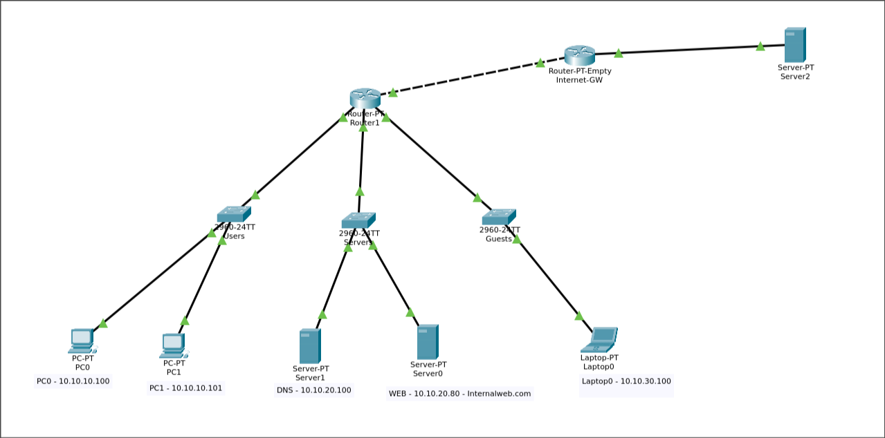
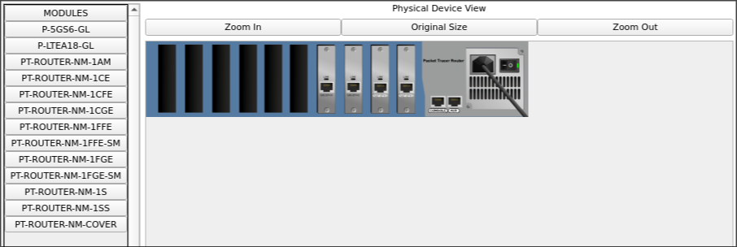
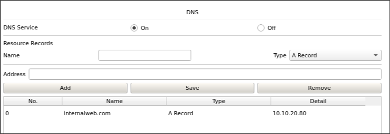
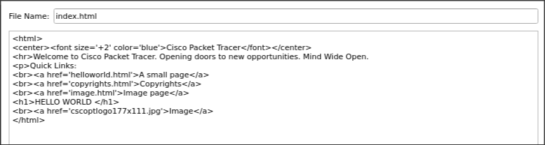
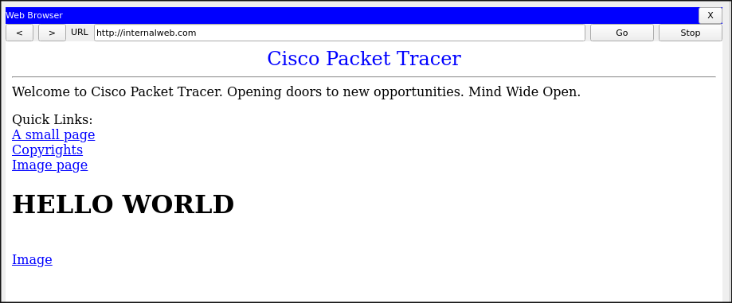
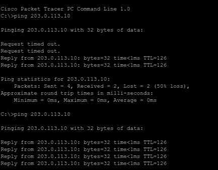
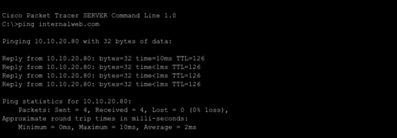

# Lab 01 -- Network Fundamentals: How Does a Website Request Reach Its Destination?

## Overview

This lab traces the path of a web request from a user's browser to a web server sitting on a completely different subnet. We start with the theory (what each protocol does and why it matters), then build a multi-subnet network in Cisco Packet Tracer, wire up the addressing, configure routing between internal networks and an external network, set up DNS and HTTP, and finish by opening `http://internalweb.com` in a browser to prove the whole chain works.

By the end you should be able to:

- Trace how a packet crosses subnets to reach a remote host.
- Explain what ARP, DHCP, DNS, TCP and UDP do in that journey.
- Build and configure a routed topology from scratch in Packet Tracer.
- Set up static routes between two routers and verify end-to-end connectivity.

---

## 1. Why networking matters in cybersecurity

Every attack, defense, and forensic investigation comes down to how data moves through a network. When a browser requests a page, dozens of protocols and devices cooperate to deliver it. If you understand each step, you can spot where something was manipulated, where a misconfiguration opened a hole, or where traffic was intercepted.

The question behind this entire lab is: **how does a website request reach its destination?** To answer it we need to understand addressing, routing, name resolution, and transport, all of which are covered below.

---

## 2. Concepts and protocols

### 2.1 The TCP/IP layer model

The TCP/IP model splits network communication into four layers. Each one has a specific job, and each one points to a different troubleshooting question when things go wrong.

| Layer | Name | What it does | Protocols | When it breaks, ask... |
|-------|------|-------------|-----------|------------------------|
| 4 | Application | User-facing services (web pages, name resolution, file transfer) | HTTP, HTTPS, DNS, DHCP, SSH | Is the service responding? |
| 3 | Transport | End-to-end delivery, reliability, port-based multiplexing | TCP, UDP | Is the connection being established? Are segments arriving? |
| 2 | Internet | Logical addressing and routing between networks | IPv4, ICMP | Can the packet reach the destination IP? |
| 1 | Link | Physical addressing and local delivery on the same segment | Ethernet, ARP, Wi-Fi | Is the frame reaching the next device on the wire? |

When your browser requests `http://internalweb.com`, the data passes down through these layers on the sending host, crosses the network, and passes back up through them on the server. Each layer wraps the data with its own header (encapsulation); each receiving layer strips that header off (decapsulation).

### 2.2 Switching and routing

Switches operate at the Link layer. A switch forwards Ethernet frames within a single LAN based on MAC addresses. It learns which MAC is reachable through which port and builds a MAC address table for forwarding decisions. Devices on the same switch (and same VLAN) talk to each other directly.

Routers operate at the Internet layer. A router forwards packets between different IP networks. When a host needs to reach a device on another subnet, it sends the packet to its default gateway, which is the router's interface on that subnet. The router checks the destination IP, looks at its routing table, and sends the packet out the right interface.

One thing worth remembering: the destination IP stays the same throughout the packet's entire journey, but the MAC address changes at every hop. The next-hop MAC gets the frame to the next router; the destination IP tells each router where the packet ultimately needs to go. Different jobs.

### 2.3 IPv4 addressing and subnets

An IPv4 address is a 32-bit number that identifies a host. Combined with a subnet mask, it splits into a network portion and a host portion.

Every subnet in this lab uses a `/24` mask (`255.255.255.0`):

- The first three octets identify the network.
- The last octet identifies the host.
- Each `/24` gives 254 usable addresses (`.1` through `.254`; `.0` is the network address, `.255` is broadcast).

### 2.4 ARP (Address Resolution Protocol)

ARP maps an IPv4 address to a MAC address on the local network. Before a host can send a frame to another device on the same subnet, it needs the destination's MAC. If it is not cached, the host broadcasts an ARP request ("Who has 10.10.10.1? Tell 10.10.10.100") and the target replies with its MAC.

ARP only works within a broadcast domain. When the destination is on a different subnet, ARP resolves the MAC of the default gateway, not the final destination.

### 2.5 DHCP (Dynamic Host Configuration Protocol)

DHCP hands out network settings automatically. A DHCP server provides an IP address, subnet mask, default gateway, DNS server address, and a lease duration.

The DHCPv4 exchange follows the DORA sequence:

1. **Discover** -- the client broadcasts looking for DHCP servers.
2. **Offer** -- a server responds with an available address and settings.
3. **Request** -- the client broadcasts which offer it accepted.
4. **Acknowledge** -- the server confirms the lease.

DHCP uses UDP port 67 (server) and 68 (client). In this lab we assign everything statically, but DHCP matters because in production most hosts get their settings this way, and a rogue DHCP server is a real attack vector.

### 2.6 DNS (Domain Name System)

DNS translates domain names (like `internalweb.com`) into IP addresses (like `10.10.20.80`). Without it, you would need to memorize IPs for every site.

When a host resolves a name:

1. It checks its local DNS cache.
2. If the name is not cached, it sends a query (typically UDP port 53) to its configured DNS server.
3. The DNS server looks up the record and replies with the IP.
4. The host caches the answer and connects using that IP.

A failed DNS lookup can look like a total outage even when the network and the server are perfectly healthy. That is why DNS is one of the first things to check when troubleshooting.

### 2.7 TCP and UDP

TCP is connection-oriented. Before any data moves, TCP runs a three-way handshake:

1. **SYN** -- the client sends a synchronization request.
2. **SYN-ACK** -- the server acknowledges and sends its own sync.
3. **ACK** -- the client acknowledges. The connection is up.

TCP gives reliable, ordered delivery with error checking and flow control. HTTP (port 80) and HTTPS (port 443) both run over TCP.

UDP is connectionless. It fires datagrams without setting up a connection first, with no guarantee of delivery or ordering. DNS (port 53) and DHCP (ports 67/68) typically use UDP because these are short exchanges where speed matters more than guaranteed delivery.

One thing to keep in mind: a port number identifies a service on a host, but it does not prove what application is actually using that port. Any program can listen on any port. In security, this matters because malware can bind to well-known ports to blend in with normal traffic.

### 2.8 Common services and ports

| Service | Protocol and port |
|---------|-------------------|
| DNS | UDP/TCP 53 |
| DHCP | UDP 67 (server), UDP 68 (client) |
| HTTP | TCP 80 |
| HTTPS | TCP/UDP 443 |
| SSH | TCP 22 |
| RDP | TCP/UDP 3389 |

---

## 3. Lab topology

### 3.1 Network diagram



The network has three internal subnets (Users, Servers, Guests), each on its own switch and connected to the central router, Router1. A second router, Internet-GW, connects Router1 to an external network where ExternalServer sits, simulating a host outside the organization.

### 3.2 Addressing table

**Internal subnets:**

| Zone | Subnet | Mask | Default gateway |
|------|--------|------|-----------------|
| Users | 10.10.10.0/24 | 255.255.255.0 | 10.10.10.1 |
| Servers | 10.10.20.0/24 | 255.255.255.0 | 10.10.20.1 |
| Guests | 10.10.30.0/24 | 255.255.255.0 | 10.10.30.1 |

**Router-to-router link:**

| Link | Subnet | Mask |
|------|--------|------|
| Router1 -- Internet-GW | 192.168.1.0/30 | 255.255.255.252 |

**External network:**

| Zone | Subnet | Mask | Default gateway |
|------|--------|------|-----------------|
| External | 203.0.113.0/24 | 255.255.255.0 | 203.0.113.1 |

**Device addressing:**

| Device | Interface | IP address | Network | Role |
|--------|-----------|------------|---------|------|
| PC0 | Fa0 | 10.10.10.100 | Users | End user workstation |
| PC1 | Fa0 | 10.10.10.101 | Users | End user workstation |
| Server1 (DNS) | Fa0 | 10.10.20.100 | Servers | DNS server |
| Server0 (WEB) | Fa0 | 10.10.20.80 | Servers | Web server (internalweb.com) |
| Laptop0 | Fa0 | 10.10.30.100 | Guests | Guest device |
| Router1 | Gig0/0 | 10.10.10.1 | Users | Gateway for Users |
| Router1 | Gig0/1 | 10.10.20.1 | Servers | Gateway for Servers |
| Router1 | Gig0/2 | 10.10.30.1 | Guests | Gateway for Guests |
| Router1 | Gig0/3 | 192.168.1.1 | Point-to-point | Link to Internet-GW |
| Internet-GW | Gig0/0 | 192.168.1.2 | Point-to-point | Link to Router1 |
| Internet-GW | Gig0/1 | 203.0.113.1 | External | Gateway for ExternalServer |
| ExternalServer | Fa0 | 203.0.113.10 | External | External host |

---

## 4. Lab walkthrough

### Phase 1 -- Building the topology

Open Packet Tracer and place these devices on the workspace:

1. One Router-PT-Empty (this will become Router1). We use the empty version because we need to add network cards manually.
2. Three 2960-24TT switches. Rename them to Users, Servers, and Guests so the topology is easy to read.
3. Two PCs (PC0 and PC1) in the Users zone.
4. Two servers in the Servers zone: Server1 for DNS, Server0 for the web server.
5. One laptop (Laptop0) in the Guests zone.

Connect each group of end devices to its switch with copper straight-through cables, and connect each switch to Router1 with straight-through cables as well.

### Phase 2 -- Adding network interfaces to Router1

The Router-PT-Empty ships with zero network interfaces. You have to install them yourself.

1. Click Router1 to open its config panel.
2. Power the router OFF (click the power switch). You cannot add modules while it is running.
3. In the physical view, find the empty module slots.
4. Drag 1CGE (1-port Gigabit Ethernet) modules into the slots. You need at least four: three for the internal subnets and one for the link to Internet-GW.
5. Power the router back ON.

Router1 now has the physical ports to connect to all three subnets plus the uplink.



### Phase 3 -- IP addressing on end devices

For each device, go to Desktop > IP Configuration and fill in the static settings.

PC0 (Users):
```
IP Address:       10.10.10.100
Subnet Mask:      255.255.255.0
Default Gateway:  10.10.10.1
DNS Server:       10.10.20.100
```

PC1 (Users):
```
IP Address:       10.10.10.101
Subnet Mask:      255.255.255.0
Default Gateway:  10.10.10.1
DNS Server:       10.10.20.100
```

Server1 / DNS (Servers):
```
IP Address:       10.10.20.100
Subnet Mask:      255.255.255.0
Default Gateway:  10.10.20.1
DNS Server:       10.10.20.100
```

Server0 / WEB (Servers):
```
IP Address:       10.10.20.80
Subnet Mask:      255.255.255.0
Default Gateway:  10.10.20.1
DNS Server:       10.10.20.100
```

Laptop0 (Guests):
```
IP Address:       10.10.30.100
Subnet Mask:      255.255.255.0
Default Gateway:  10.10.30.1
DNS Server:       10.10.20.100
```

Two things people often miss here:

The DNS server (Server1) needs its own DNS address set to `10.10.20.100`, pointing to itself. This feels redundant, but the operating system does not automatically know that it is running a DNS service. Without this entry, Server1 cannot resolve domain names for its own processes.

Every host needs a default gateway. Without one, the host can only talk to devices on its own subnet. Traffic headed anywhere else has no exit path.

### Phase 4 -- Same-network connectivity test

Before touching the router config, confirm that devices on the same subnet can reach each other. This validates the switch, the cables, and the IP settings.

From PC0, open the command prompt (Desktop > Command Prompt):

```
C:\> ping 10.10.10.101
```

You should get replies. If not, check that both PCs connect to the same switch, that the IPs are on the same subnet, and that the cable indicators are green on both ends.

Do the same between the servers. From Server1:

```
C:\> ping 10.10.20.80
```

Cross-subnet pings (like PC0 to Server1) will fail at this point because Router1 is not configured yet. That is expected.

### Phase 5 -- Router1 configuration

This is where inter-subnet communication gets enabled. We assign an IP to each of Router1's interfaces and bring them up.

Open Router1's CLI tab:

```
Router> enable
Router# configure terminal
```

Users interface (toward the 10.10.10.0/24 switch):

```
Router(config)# interface GigabitEthernet0/0
Router(config-if)# ip address 10.10.10.1 255.255.255.0
Router(config-if)# no shutdown
Router(config-if)# exit
```

Servers interface (toward the 10.10.20.0/24 switch):

```
Router(config)# interface GigabitEthernet0/1
Router(config-if)# ip address 10.10.20.1 255.255.255.0
Router(config-if)# no shutdown
Router(config-if)# exit
```

Guests interface (toward the 10.10.30.0/24 switch):

```
Router(config)# interface GigabitEthernet0/2
Router(config-if)# ip address 10.10.30.1 255.255.255.0
Router(config-if)# no shutdown
Router(config-if)# exit
```

```
Router(config)# exit
Router# write memory
```

`no shutdown` is easy to forget. Router interfaces are administratively down by default (unlike switch ports), so without this command the interface stays off even after you assign an IP.

`write memory` saves the running config to NVRAM. Without it, everything disappears on a reboot.

Verify:

```
Router# show ip interface brief
```

All three interfaces should show their assigned IPs with status `up` and protocol `up`.

### Phase 6 -- Cross-network connectivity test

With Router1 configured, devices on different subnets can now reach each other through the router.

From PC0 (10.10.10.100):

```
C:\> ping 10.10.20.100
C:\> ping 10.10.20.80
C:\> ping 10.10.30.100
```

All should succeed. If the first ping in a sequence shows one timeout followed by replies, that is normal. The first packet triggers an ARP request to resolve the gateway's MAC, and the ICMP echo times out while ARP completes.

From Laptop0 (10.10.30.100):

```
C:\> ping 10.10.10.100
C:\> ping 10.10.20.80
```

### Phase 7 -- DNS server configuration

Now that the network is connected, we set up DNS so hosts can resolve `internalweb.com` to the web server's IP.

1. Click Server1 (DNS).
2. Go to Services > DNS.
3. Turn the DNS service ON.
4. Add a record:
   - Name: `internalweb.com`
   - Type: A Record
   - Address: `10.10.20.80`
5. Click Add.



This record tells the DNS server: when someone asks for `internalweb.com`, answer with `10.10.20.80`.

Test it from PC0:

```
C:\> nslookup internalweb.com
```

The response should come back with `10.10.20.80`.

### Phase 8 -- Web server configuration

1. Click Server0 (WEB).
2. Go to Services > HTTP.
3. Make sure HTTP is ON.
4. Edit the `index.html` file:

```html
<html>
<center><font size='+2' color='blue'>Cisco Packet Tracer</font></center>
<hr>
Welcome to Cisco Packet Tracer. Opening doors to new opportunities. Mind Wide Open.
<p>Quick Links:
<br><a href='helloworld.html'>A small page</a>
<br><a href='copyrights.html'>Copyrights</a>
<br><a href='image.html'>Image page</a>
<h1>HELLO WORLD </h1>
<br><a href='cscoptlogo177x111.jpg'>Image</a>
</html>
```

The `<h1>HELLO WORLD</h1>` is our addition, so we can immediately tell this is our custom page when it loads.



### Phase 9 -- Accessing the website by domain name

This test validates the entire chain: IP addressing, routing, DNS resolution, and HTTP.

1. Click PC0.
2. Open Desktop > Web Browser.
3. Type `http://internalweb.com` in the URL bar.
4. Click Go.



If the page shows "HELLO WORLD" along with the Packet Tracer welcome text, everything is working.

Here is what happened behind the scenes:

1. PC0 needs to find the IP for `internalweb.com`. It sends a DNS query (UDP port 53) to `10.10.20.100`.
2. Since the DNS server is on a different subnet, the query goes to the default gateway at `10.10.10.1` (Router1).
3. Router1 checks its routing table and forwards the packet out the Servers interface to the DNS server.
4. The DNS server finds the A record for `internalweb.com` pointing to `10.10.20.80` and sends the answer back.
5. PC0 now knows the IP. It starts a TCP three-way handshake (SYN, SYN-ACK, ACK) with the web server on port 80.
6. Once the TCP connection is up, PC0 sends an HTTP GET for `/index.html`.
7. The web server replies with the HTML.
8. The browser renders the page.

A failure at any of these steps (wrong gateway, DNS misconfiguration, HTTP service turned off, interface down) breaks the chain. Knowing which step failed is the starting point for both troubleshooting and security analysis.

### Phase 10 -- Inter-router link and static routing

Up to this point all communication happens within the internal network. Now we connect Router1 to Internet-GW so that internal hosts can reach ExternalServer on the `203.0.113.0/24` network.

**Prepare Internet-GW:**

Internet-GW is also a Router-PT-Empty, so it needs network cards. Power it off, add at least two 1CGE modules (one for the link to Router1, one for the connection to ExternalServer), and power it back on.

Connect Router1's Gig0/3 to Internet-GW's Gig0/0 with a copper cross-over cable (router-to-router). Connect Internet-GW's Gig0/1 to ExternalServer with a copper straight-through cable.

**Configure Internet-GW's interfaces:**

```
Router> enable
Router# configure terminal
```

Interface facing Router1:

```
Router(config)# interface GigabitEthernet0/0
Router(config-if)# ip address 192.168.1.2 255.255.255.252
Router(config-if)# no shutdown
Router(config-if)# exit
```

Interface facing ExternalServer:

```
Router(config)# interface GigabitEthernet0/1
Router(config-if)# ip address 203.0.113.1 255.255.255.0
Router(config-if)# no shutdown
Router(config-if)# exit
```

**Configure Router1's uplink interface:**

On Router1's CLI:

```
Router# configure terminal
Router(config)# interface GigabitEthernet0/3
Router(config-if)# ip address 192.168.1.1 255.255.255.252
Router(config-if)# no shutdown
Router(config-if)# exit
```

At this point the two routers can ping each other across the `192.168.1.0/30` link, but neither one knows how to reach the networks on the other side. That is what static routes fix.

**Static routes on Router1:**

Router1 already knows the three internal subnets (they are directly connected), but it has no idea that `203.0.113.0/24` exists. We tell it: to reach that network, forward packets to Internet-GW.

```
Router(config)# ip route 203.0.113.0 255.255.255.0 192.168.1.2
Router(config)# exit
Router# write memory
```

**Static routes on Internet-GW:**

Internet-GW knows its directly connected networks (`192.168.1.0/30` and `203.0.113.0/24`), but it has no path back to the three internal subnets. We add one route per subnet:

```
Router(config)# ip route 10.10.10.0 255.255.255.0 192.168.1.1
Router(config)# ip route 10.10.20.0 255.255.255.0 192.168.1.1
Router(config)# ip route 10.10.30.0 255.255.255.0 192.168.1.1
Router(config)# exit
Router# write memory
```

Without these return routes, packets from internal hosts would reach ExternalServer through Router1 and Internet-GW, but the replies would have no way back.

**Configure ExternalServer:**

On ExternalServer, set the static IP:

```
IP Address:       203.0.113.10
Subnet Mask:      255.255.255.0
Default Gateway:  203.0.113.1
DNS Server:       10.10.20.100
```

**Why /30 for the router link?**

The link between Router1 and Internet-GW is a point-to-point connection with only two devices. A `/30` mask (`255.255.255.252`) gives exactly two usable addresses, which is the standard practice for router-to-router links. No reason to waste a /24 (254 addresses) on a cable with two endpoints.

### Phase 11 -- External connectivity test

Time to verify that internal hosts can reach ExternalServer and that ExternalServer can reach back into the internal network.

From PC0, ping ExternalServer:

```
C:\> ping 203.0.113.10
```



The first couple of pings may time out (ARP resolution across multiple hops takes a moment), but the rest should come back fine. The `TTL=126` in the replies confirms the packet crossed two routers: the default TTL starts at 128, and each router hop decrements it by 1.

From ExternalServer, test connectivity back to the internal web server by pinging its domain name:

```
C:\> ping internalweb.com
```



This test is interesting because it validates two things at once: DNS resolution (ExternalServer's DNS is set to `10.10.20.100`, which is two hops away) and routing back into the internal network. The ping resolves to `10.10.20.80` and the replies come back, confirming that the static routes work in both directions.

---

## 5. Troubleshooting checklist

If something fails, work through these checks in order. If a lower-level check fails, everything above it will fail too.

| Check | Command / action | What it confirms |
|-------|-----------------|------------------|
| Interface status | `show ip interface brief` on both routers | Interfaces are up/up |
| Local connectivity | Ping between hosts on the same subnet | Switch and addressing are correct |
| Gateway reachability | `ping 10.10.10.1` from PC0 | Host can reach its gateway |
| Cross-subnet (internal) | `ping 10.10.20.80` from PC0 | Router1 is forwarding between subnets |
| Router-to-router link | `ping 192.168.1.2` from Router1 | The inter-router link is up |
| External reachability | `ping 203.0.113.10` from PC0 | Static route on Router1 works |
| Return path | `ping 10.10.10.100` from ExternalServer | Static routes on Internet-GW work |
| DNS resolution | `nslookup internalweb.com` from PC0 | DNS service is running and the record exists |
| HTTP (by IP) | Browse to `http://10.10.20.80` | Web server is serving pages (bypasses DNS) |
| HTTP (by name) | Browse to `http://internalweb.com` | Full chain works end to end |

---

