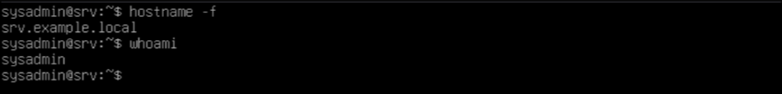
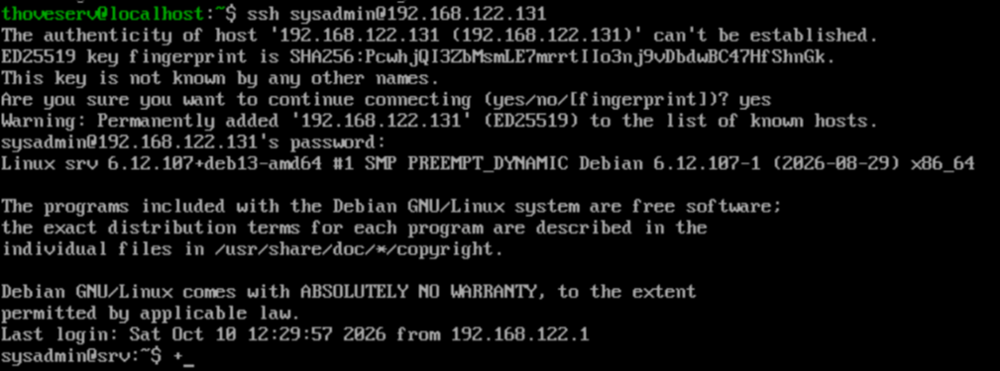
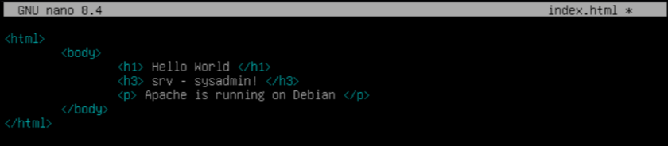
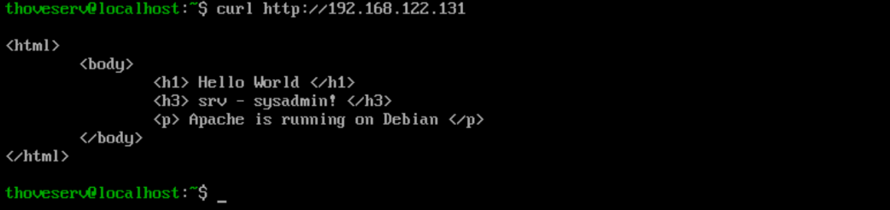
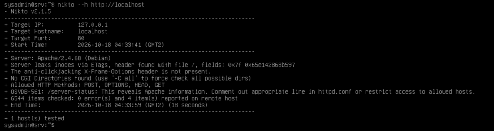
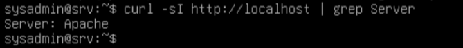
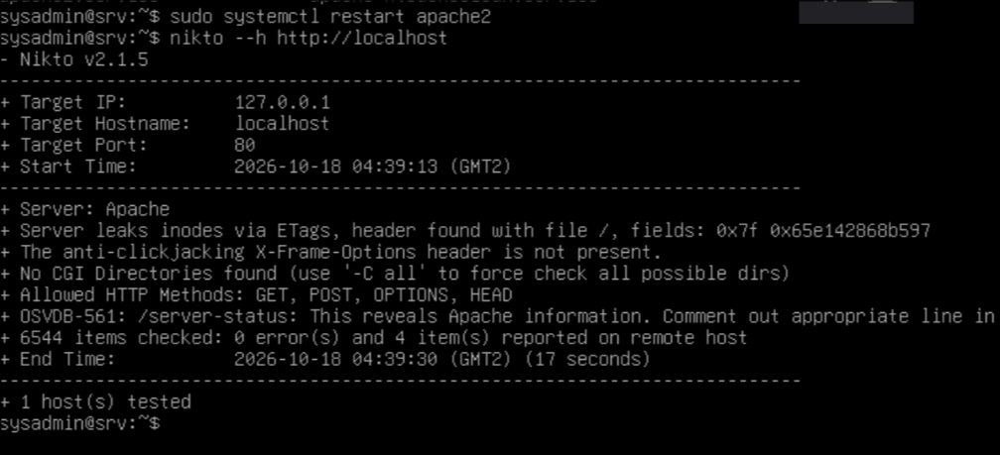
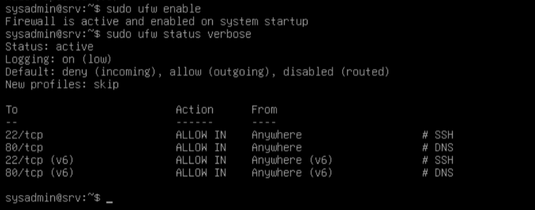

# Lab 02: Servers and operating systems

## Overview

Every service on a network is delivered by a server, and every server is only as safe as the operating system and configuration underneath it. This lab starts with the theory (why organizations depend on servers, what threatens them, and what hardening means), then builds a Debian server inside a virtual machine, reaches it remotely, installs a web service, and finishes by reducing its attack surface.

By the end you should be able to:

- Explain how a business depends on IT infrastructure and where servers and operating systems fit in.
- Describe the main types of malware and the phases of a cyberattack, and say where a defender can interrupt them.
- Justify the choice of Debian for a server using clear criteria, and explain what open source software means in practice.
- Build a minimal Linux server in a virtual machine, administer it over SSH, and run a web service on it.
- Apply basic hardening to the server, guided by the CIS Benchmarks.

---

## 1. Why servers and operating systems matter in cybersecurity

Lab 01 followed a web request across the network until it reached a web server. We treated that server as a box that simply answers. This lab opens the box. A server is a computer running an operating system, with services listening on ports, administered by people, and holding data the organization cannot afford to lose. Each one of those elements is a place where something can go wrong.

From an attacker's point of view, servers are high-value targets. One server often serves hundreds of clients, so compromising it is worth far more than compromising a single laptop. And the operating system is the layer that decides who can read a file, start a process or open a port. In practice, attackers rarely need a sophisticated exploit: a weak password, an outdated package or a service nobody remembers installing is usually enough.

The question behind this lab is: how do you build a server that does its job and still resists attack? To answer it we need to understand what the server is for, what threatens it, what we build it with, and how we reduce what can be attacked.

---

## 2. Concepts and technologies

### 2.1 From business to infrastructure

An organization exists to deliver value: sell a product, treat a patient, move money. Those are business processes, and today almost all of them run on information technology. When IT stops, the business stops.

What keeps it running is the information systems infrastructure: hardware, software, networks and data, plus the people and procedures that operate them. Infrastructure is built in layers, and each layer depends on the one below it.

| Layer | What it is | Examples |
|-------|-----------|----------|
| Users and procedures | The people and the rules they follow | Staff, administrators, backup routines |
| Applications and services | Software that delivers something useful | Website, database, mail service |
| Operating system | Software that manages the machine | Debian, Windows Server |
| Hardware | The physical machine | CPU, RAM, disks, power |
| Network | The links between machines | Switches, routers, cables |

When a layer fails, everything above it fails too. That is why troubleshooting and security analysis are done layer by layer, the same way the TCP/IP model worked in Lab 01.

### 2.2 Client-server architecture

Client-server is the model behind almost everything on a network. A client sends a request, and a server processes it and returns a response. One server attends many clients at the same time.

"Client" and "server" describe roles, not hardware. The same machine can be a client in one conversation and a server in another. What makes a machine a server in practice is that it runs a service that waits for requests and is expected to be available all the time.

Because one server serves many clients, a single compromise multiplies. That concentration of risk is the reason servers deserve more protection than ordinary workstations.

### 2.3 The operating system

The operating system (OS) sits between the hardware and the applications. Its core jobs are managing processes and CPU time, memory, storage, devices and network, and users and permissions.

The part of the OS that talks directly to the hardware is the kernel. Around it sits everything else the user touches: the shell, the system utilities and the services. This distinction matters in section 2.5, because "Linux" and "Debian" are not the same thing.

A desktop OS optimizes for interaction: graphical interface, ease of use, multimedia. A server OS optimizes for staying up for months without supervision, being administered remotely, and running only what it needs. The security angle is direct: the OS is where access control is enforced. If an attacker takes control of the OS, particularly an administrator account, every protection built on top of it stops meaning anything.

### 2.4 Open source software

Open source software is software whose source code is publicly available, and which anyone may use, study, modify and redistribute under the terms of its license.

| | Proprietary | Open source |
|---|-------------|-------------|
| Source code | Closed | Open and auditable |
| License cost | Usually paid | Usually free |
| Vendor dependence | High | Low |
| Who fixes bugs | The vendor | The community and anyone who contributes |

Open source does not mean "automatically secure." Open code can be reviewed by many people, but only if someone actually does it. The Heartbleed bug sat unnoticed in OpenSSL for about two years. The real advantage is that anyone can inspect the code, and fixes tend to arrive quickly once a flaw is found. Applying those fixes is still the administrator's job.

### 2.5 Linux, Debian and choosing a distribution

Linux is a kernel, created by Linus Torvalds in 1991. By itself, a kernel is not something you can install and use. A distribution (distro) packages the Linux kernel with system utilities, a package manager, a default configuration and a set of software, producing a complete operating system.

Debian is one of the oldest distributions, maintained by a community project since 1993. It has a reputation for stability and for a careful release process, which is why it is widely used on servers. Debian publishes three branches:

| Branch | Purpose |
|--------|---------|
| Stable | The released version. Packages are older but thoroughly tested. This is what servers should run. |
| Testing | Packages being prepared for the next stable release. |
| Unstable (sid) | Where new versions arrive first. Expect breakage. |

With hundreds of distributions to choose from, the decision should follow criteria, not fashion. DistroWatch (distrowatch.com) is a site that lists and tracks distributions and their versions. Useful criteria are the intended purpose, the release and support lifecycle, the size of the community, and the resources the machine has available.

### 2.6 Malware

Malware is software designed to harm, spy on or take control of a system without the owner's consent.

| Type | What it does | How it typically spreads |
|------|-------------|--------------------------|
| Virus | Attaches itself to legitimate files and runs when they run | Infected files, removable media |
| Worm | Copies itself across the network without user action | Unpatched network services |
| Trojan | Pretends to be something useful while doing something else | Fake installers, cracked software |
| Ransomware | Encrypts data and demands payment for the key | Phishing email, exposed services |
| Spyware | Quietly collects information (credentials, activity) | Bundled software, malicious downloads |

On a workstation, malware usually arrives through a user's click. On a server, nobody is browsing the web or opening attachments, so it mostly arrives through exposed services, outdated software and stolen or guessed passwords. That is why server security depends so heavily on what is installed, what is listening, and how current it is.

### 2.7 Anatomy of a cyberattack

An attack follows phases, and that is good news for defenders: if you know the phases, you can put a defense in each of them.

| Phase | What the attacker does | Defender's question |
|-------|-----------------------|---------------------|
| Reconnaissance | Collects information: IP ranges, open ports, software versions | What does the outside world see of us? |
| Intrusion | Gets a first foothold: stolen password, phishing, exposed service | Which doors are open, and who guards them? |
| Exploitation | Abuses a vulnerability or misconfiguration to gain control | Is everything patched and correctly configured? |
| Persistence | Stays in, creates accounts, moves to other machines | Would we notice a new account or unusual traffic? |
| Impact | Steals, encrypts or destroys data | Can we recover? |

Frameworks such as the Lockheed Martin Cyber Kill Chain and MITRE ATT&CK break this down into finer steps, but the logic is the same: an attack stopped early costs far less than one that reaches the last phase.

### 2.8 Cybersecurity as a continuous process

Security is not a product you buy and install. It is a continuous process involving people, procedures and technology. There is no total security, only risk management.

| Activity | Goal | How it shows up in this lab |
|----------|------|-----------------------------|
| Prevent | Make attacks harder | Minimal installation, updates, secure configuration |
| Detect | Notice when something is wrong | Checking which ports are listening, reading logs |
| Respond | Contain and fix an incident | Response plans (discussed, not practiced here) |
| Recover | Return to normal operation | Backups, and snapshots of the virtual machine |

Three principles run through everything that follows:

- CIA triad: confidentiality (only authorized people read the data), integrity (data is not altered without authorization) and availability (the service works when needed).
- Least privilege: every user and process gets only the access it needs, nothing more.
- Defense in depth: several independent layers of protection, so that one failure does not mean total compromise.

### 2.9 Virtualization

Virtualization lets one physical computer run several virtual machines (VMs), each behaving like a separate computer with its own operating system. The physical machine is the host, the VMs are guests, and the software that creates and manages them is the hypervisor.

Hypervisors come in two types. Type 1 (bare-metal) hypervisors run directly on the hardware and are what data centers use (VMware ESXi, Microsoft Hyper-V, KVM). Type 2 (hosted) hypervisors run as an application on top of a normal OS (VirtualBox). KVM, the one used in this lab, is technically a Type 1 hypervisor built into the Linux kernel, managed through libvirt and tools such as virt-manager.

For learning, the benefits are practical: guests are isolated from the host, so a mistake does not damage the real computer. If you break a VM, you delete it and create another, or return to a snapshot (a saved state of the VM).

The virtual network adapter of a VM can work in different modes:

| Mode | VM reaches the outside | Other devices reach the VM | Typical use |
|------|-----------------------|---------------------------|-------------|
| NAT | Yes | No (unless ports are forwarded) | Browsing and updates from an isolated VM |
| Bridged | Yes | Yes | Server that other devices must reach |
| Host-only | No | Only the host | Private tests between host and VM |

In a NAT network such as the default libvirt network (`192.168.122.0/24`), the VM can reach the outside through the host, and other VMs on the same network can reach it. That is what we use in this lab.

### 2.10 Attack surface and minimal installation

The attack surface is the sum of all the points where an attacker could try to get in: installed software, running services, open ports, user accounts. Every package you install is code that may contain a vulnerability and code you have to keep updated. The simplest and most effective way to protect a server is to reduce this surface from the start.

This is why a server is installed without a graphical environment. Nobody needs a desktop to serve a web page, and a desktop brings hundreds of extra packages. A server without one is lighter, faster, and has fewer components to attack. The price is that all administration happens through the command line.

### 2.11 Users, root and least privilege

Linux separates users sharply. At the top is root, the superuser, with unrestricted access to the whole system. Root can read any file, stop any process and delete anything, including the system itself. There is no recycle bin and no confirmation.

That is why the principle of least privilege matters here:

- Use a normal account for daily work, where mistakes are contained.
- Elevate to root only for a specific task that requires it, and leave as soon as it is done.
- Never expose root directly to the network.

The shell prompt tells you which one you are using: `$` for a normal user, `#` for root. Treat the `#` as a warning sign.

There are two common ways to elevate privileges: `su -` opens a full session as root (and asks for root's password), while `sudo` runs a single command with elevated rights (and asks for your own password). The hyphen in `su -` matters because it loads root's own environment. On Debian, `sudo` is only configured by default if you leave the root password empty during installation; if you set one, you start with `su -`.

### 2.12 Remote administration with SSH

A server in a data center, or in a VM without a screen, is administered remotely. SSH (Secure Shell) is the standard tool for this. An SSH server (`sshd`) listens on port 22/TCP, and an SSH client connects to it and gets a remote command line.

All traffic inside an SSH session is encrypted. This is the opposite of Telnet, the older tool SSH replaced, which sent everything (passwords included) in plaintext over port 23.

SSH is the most frequent target of automated attacks. Any server with port 22 exposed to the internet will see constant login attempts within minutes. Strong passwords, no direct root login, and key-based authentication are the first defenses.

### 2.13 Packages and repositories

On Linux, software is installed through a package manager. On Debian and its derivatives this is APT, which works on top of `dpkg`. APT downloads packages from repositories defined in `/etc/apt/sources.list`.

Official repositories sign their packages cryptographically, and APT verifies the signature before installing. Installing software only from official sources is a first line of defense. Adding unknown repositories hands control of your server to someone you have no reason to trust. This is a supply chain risk.

Two operations are often confused:

- `apt update` refreshes the list of available packages. It installs nothing.
- `apt upgrade` installs the newer versions of the packages already on the system.

Regular updates matter because most successful attacks exploit vulnerabilities that are already known and already fixed. Public vulnerabilities receive a CVE identifier (Common Vulnerabilities and Exposures), and the Debian security team publishes fixes for supported releases.

### 2.14 Services, ports and listening sockets

A service is a program that runs in the background waiting for requests, usually called a daemon on Linux. For a client to reach it, it listens on a port. On modern Debian, daemons are managed by `systemd`.

Every listening port is a possible entry point. An administrator regularly lists which ports are open and which process owns each one. If a port appears that nobody recognizes, that is a reason to investigate. The classic tool for this is `netstat` (from the `net-tools` package); its modern replacement is `ss`.

The server in this lab runs two services:

| Service | Daemon | Protocol and port | Role |
|---------|--------|-------------------|------|
| SSH | `sshd` | TCP 22 | Remote administration |
| Web (Apache) | `apache2` | TCP 80 | Delivers web pages over HTTP |

Apache is one of the oldest and most widely used web servers. On Debian it is installed from the `apache2` package, starts automatically, and serves a default page from `/var/www/html`. Every service added is a new entry on the attack surface. It should be there because the server's role requires it, and it should be kept up to date.

### 2.15 Hardening and the CIS Benchmarks

Hardening is the process of reducing a system's attack surface and tightening its configuration beyond the defaults. Default installations favor convenience and compatibility. Hardening shifts the balance toward security.

The CIS Benchmarks, published by the Center for Internet Security, are configuration guides developed by a community of experts for a wide range of operating systems and software, including Debian. They define two profiles: Level 1, practical measures with little impact on functionality, and Level 2, for environments that need stronger security and can accept some loss of functionality.

| Area | Example measure | Why it matters |
|------|----------------|----------------|
| Software | Remove packages and services nobody needs | Fewer vulnerabilities to exploit |
| Access | No root login over SSH, strong passwords | Stops the easiest intrusions |
| Network | Firewall allowing only required ports | Closes doors that are not needed |
| Updates | Regular patching from official repositories | Fixes known vulnerabilities |
| Monitoring | Review of logs and listening ports | Detects what prevention missed |

Hardening is not a one-time task. New software, new vulnerabilities and new requirements keep changing the picture, so hardening is a routine, not an event.

---

## 3. Lab environment

### 3.1 What we are building

The lab builds a single server: a Debian virtual machine named `srv`, installed without a graphical interface, connected to the virtual network in NAT mode, and administered remotely from another VM. Later phases turn it into a working server (remote access, packages, web service) and then harden it.

| Parameter | Value |
|-----------|-------|
| Machine name | `srv` |
| Domain | `example.local` |
| FQDN | `srv.example.local` |
| Operating system | Debian stable, 64-bit |
| Memory | 1024 MB |
| CPU | 1 (2 if the host can spare them) |
| Disk | 10 GB, dynamically allocated |
| Network adapter | NAT (default libvirt network) |
| Graphical interface | None |
| Software selection | SSH server and standard system utilities |
| Accounts | `root` and one normal user (`sysadmin`) |
| IP address | `192.168.122.131` |

### 3.2 What the host needs

- A hypervisor installed (virt-manager/KVM, VirtualBox or VMware Workstation).
- The Debian netinst ISO from the official site, `debian.org`. This small image downloads the rest of the system during installation, so the host needs internet access.
- About 2 GB of free RAM and 10 GB of free disk space.
- Hardware virtualization (Intel VT-x or AMD-V) enabled in the BIOS/UEFI. If the VM refuses to start with a 64-bit system, this is almost always the cause.

---

## 4. Lab walkthrough

### Phase 1: Installing the Debian server

The Debian installer is a guided process. This section records the decisions that matter for a server and the reason behind each one.

#### 1.1 Creating the virtual machine

In your hypervisor (virt-manager, VirtualBox, or similar), create a new VM with the following settings:

| Setting | Value | Why |
|---------|-------|-----|
| Name | `srv` | A clear, short name for the machine. |
| ISO image | The Debian netinst ISO | This is the installation medium. |
| Type | Linux / Debian (64-bit) | Enables the right defaults. |
| Memory | 1024 MB | Enough for a server without a graphical interface. |
| Processors | 1 (or 2) | A text-only server needs very little CPU. |
| Disk | 10 GB, dynamically allocated | The file grows only as data is written. |

#### 1.2 Network configuration

The VM's network adapter should be connected to a network that allows communication with other VMs. In this lab we use the default libvirt NAT network (`192.168.122.0/24`), which lets VMs reach the internet and communicate with each other.

#### 1.3 Installer decisions

| Installer prompt | What to choose | Why |
|------------------|----------------|-----|
| Language | English | Error messages and documentation are easiest to search in English. |
| Location | Your country | Sets the time zone and the nearest package mirror. |
| Keyboard layout | The layout you are actually using | The installer uses it to read your passwords. Wrong layout means a different password than you think. |
| Hostname | `srv` | The machine's own name. |
| Domain name | `example.local` | Together with the hostname forms the FQDN `srv.example.local`. |
| Root password | A strong password | Enables the root account. |
| New user | Full name, username `sysadmin`, strong password | The normal account for daily use. |
| Partitioning | Guided, entire disk, all files in one partition | Fine for a lab. Production servers usually separate some directories. |
| Package mirror | Your country, `deb.debian.org` | The official repository (section 2.13). |
| Software selection | Only SSH server and standard system utilities | Minimal installation (section 2.10). |
| GRUB boot loader | Yes, on the VM's disk | Without it the system will not boot. |

On the software selection screen, leave every desktop environment unchecked. Leave "web server" unchecked as well, because we install Apache by hand in a later phase. Keep only SSH server and standard system utilities. This gives us a smaller attack surface, lower resource usage, and a realistic server environment managed entirely through the command line.

When the installer finishes, it asks to reboot. If the VM returns to the installer menu instead of starting Debian, remove the ISO from the VM's storage settings and restart.

#### 1.4 First boot and verification

At the login prompt, log in with the normal user (`sysadmin`), not root. The prompt should end in `$`, and the screen is text only. Confirm the FQDN:

```
sysadmin@srv:~$ hostname -f
srv.example.local
sysadmin@srv:~$ whoami
sysadmin
```



### Phase 2: Remote access over SSH

From this point on, we stop using the hypervisor console and work from another machine. This is how real servers are administered: you never sit at the machine itself.

In this lab, the SSH client is a CentOS VM on the same virtual network. From it, connect to the Debian server:

```
ssh sysadmin@192.168.122.131
```

The first time you connect, SSH shows the server's key fingerprint and asks you to confirm:

```
The authenticity of host '192.168.122.131 (192.168.122.131)' can't be established.
ED25519 key fingerprint is SHA256:xxxxxxxxxxxxxxxxxxxxxxxxxxxxxxxxxxxxxxxxxxx.
Are you sure you want to continue connecting (yes/no/[fingerprint])?
```

Type `yes`. SSH saves the fingerprint in `~/.ssh/known_hosts`. If the fingerprint ever changes without explanation (you did not reinstall the server, for example), SSH will refuse to connect and warn you. That warning means either the server was reinstalled or someone is intercepting the connection. Do not ignore it.

Once connected, you should see the `sysadmin@srv:~$` prompt. Everything between your terminal and the server is now encrypted inside the SSH tunnel.



### Phase 3: Privileges and package sources

#### 3.1 Elevating to root

The normal account cannot install software or edit system files. We need root for the next steps.

```
sysadmin@srv:~$ su - root
Password:
root@srv:~#
```

The prompt changes from `$` to `#`. The hyphen in `su -` loads root's full environment (PATH, home directory). Without it you get root privileges but keep the normal user's environment, which can cause confusing errors.

#### 3.2 Configuring package repositories

Check what repositories the installer set up:

```
root@srv:~# cat /etc/apt/sources.list
```

For a server that needs all available packages, the line should include `contrib`, `non-free` and `non-free-firmware`. If any are missing, edit the file:

```
root@srv:~# nano /etc/apt/sources.list
```

A complete entry for Debian stable (trixie at the time of writing) looks like:

```
deb https://deb.debian.org/debian/ trixie main contrib non-free non-free-firmware
deb https://deb.debian.org/debian-security/ trixie-security main contrib non-free non-free-firmware
deb https://deb.debian.org/debian/ trixie-updates main contrib non-free non-free-firmware
```

Save and update the package index:

```
root@srv:~# apt update
```

#### 3.3 Installing sudo

Installing `sudo` is standard practice. It lets the normal user run individual commands as root without opening a full root session, and it logs every elevated command, which matters for auditing.

```
root@srv:~# apt install sudo
root@srv:~# adduser sysadmin sudo
```

Log out of the root session and out of SSH, then reconnect:

```
root@srv:~# exit
sysadmin@srv:~$ exit
```

```
ssh sysadmin@192.168.122.131
```

After reconnecting, verify that sudo works:

```
sysadmin@srv:~$ sudo whoami
root
```

The group change only takes effect in new sessions, which is why we logged out and back in. From here on, we use `sudo` because it is more granular: one command at a time, with a log of what was run.

#### 3.4 Applying pending updates

Before installing anything new, bring the base system up to date:

```
sysadmin@srv:~$ sudo apt update
sysadmin@srv:~$ sudo apt upgrade
```

This pulls in security fixes published since the installation ISO was built. On a server, these updates should be routine.

### Phase 4: Baseline check

Before installing any services, record what the server already exposes. This is your baseline. Anything that appears later and is not something you installed should raise a question.

```
sysadmin@srv:~$ sudo ss -ltnup
```

`ss` replaces the older `netstat` (which needs the `net-tools` package). The flags: `-l` listening, `-t` TCP, `-n` numeric, `-u` UDP, `-p` show process.

On a minimal Debian with only SSH, you should see `sshd` on port 22 and possibly `systemd-resolve` on port 53 (loopback only, for local DNS stub resolution). Nothing else. That is the minimal attack surface from section 2.10.

### Phase 5: Apache web server

#### 5.1 Installation

```
sysadmin@srv:~$ sudo apt install apache2
```

APT installs the package and its dependencies, creates the configuration under `/etc/apache2/`, drops a default page in `/var/www/html/`, and starts the service automatically.

Verify it is running:

```
sysadmin@srv:~$ sudo systemctl status apache2
```

Look for `active (running)`. Check that port 80 appeared:

```
sysadmin@srv:~$ sudo ss -ltnp | grep :80
```

You should see `apache2` listening on `0.0.0.0:80`, which means it accepts connections from any interface. Compare this with the baseline from Phase 4: port 80 is new, and you know exactly why.

#### 5.2 Replacing the default page

The default page is fine for testing, but let us replace it with something we recognize.

```
sysadmin@srv:~$ cd /var/www/html/
sysadmin@srv:/var/www/html$ sudo cp index.html index.html.bak
sysadmin@srv:/var/www/html$ sudo nano index.html
```

Replace the contents with:

```html
<html>
<body>
    <h1> Hello World </h1>
    <h3> srv - sysadmin! </h3>
    <p> Apache is running on Debian </p>
</body>
</html>
```



Save the file. No need to restart Apache; it reads the file on each request.

#### 5.3 Testing from the network

From the CentOS VM, test with curl:

```
curl http://192.168.122.131
```

You should see the HTML you just wrote. This confirms that the network adapter, Apache, and the custom page are all working.



### Phase 6: Nikto scanning and information disclosure

Nikto is an open source web server scanner. It checks for common misconfigurations, outdated software versions, default files that should have been removed, and known issues. It is not an exploit tool; it tells you what an attacker would notice about your server from the outside.

Run Nikto only against servers you own or have explicit permission to test. Scanning someone else's server without authorization is illegal in most jurisdictions.

#### 6.1 Installation and first scan

```
sysadmin@srv:~$ sudo apt install nikto
```

Scan the local web server:

```
sysadmin@srv:~$ nikto -h http://localhost
```

On a fresh Apache install, expect findings like:

- The `Server` header revealing the Apache version and the OS ("Apache/2.4.68 (Debian)").
- Missing security headers (X-Frame-Options, X-Content-Type-Options).
- The ETag header leaking inode information (OSVDB-561).

These are not critical vulnerabilities, but they are information an attacker can use. The version number, for instance, tells an attacker exactly which CVEs to try.



#### 6.2 Reducing information disclosure

The most immediate fix is to stop Apache from advertising its version. Edit the security configuration:

```
sysadmin@srv:~$ sudo nano /etc/apache2/conf-enabled/security.conf
```

Find and set these two directives:

```
ServerTokens Prod
ServerSignature Off
```

`ServerTokens Prod` changes the `Server` header from `Apache/2.4.68 (Debian)` to just `Apache`. `ServerSignature Off` removes the version line from error pages.

Restart Apache and verify:

```
sysadmin@srv:~$ sudo systemctl restart apache2
sysadmin@srv:~$ curl -sI http://localhost | grep Server
Server: Apache
```



The header now shows only the product name, no version. Run Nikto again and compare the output:

```
sysadmin@srv:~$ nikto -h http://localhost
```

The version disclosure finding should be gone. The server now reports `Server: Apache` instead of the full version string.



### Phase 7: Hardening

The server is functional. It has SSH and Apache running, both reachable from the network. Now we go back through it and tighten what the defaults left loose. This follows section 2.15 and the CIS Benchmarks methodology: each change has a reason, and we verify it after applying it.

#### 7.1 Take a snapshot first

Before making changes, take a snapshot of the VM in your hypervisor. Name it something like "before-hardening." If anything in this phase breaks the server, you can restore to this point in seconds. This is the "recover" step from the security cycle in section 2.8.

#### 7.2 SSH hardening

SSH is the front door. Every server with port 22 exposed sees automated login attempts within minutes. We lock it down.

Edit the SSH daemon configuration:

```
sysadmin@srv:~$ sudo nano /etc/ssh/sshd_config
```

Find and set these directives:

```
PermitRootLogin no
MaxAuthTries 3
LoginGraceTime 60
PasswordAuthentication yes
```

- `PermitRootLogin no` blocks direct root login over SSH. An attacker who guesses the root password gets full access immediately. With this set, they need to know both a regular username and its password, then still need to elevate.
- `MaxAuthTries 3` disconnects after three failed password attempts per session.
- `LoginGraceTime 60` gives 60 seconds to complete authentication before the server drops the connection.

Restart SSH and test from a second terminal before closing the current one:

```
sysadmin@srv:~$ sudo systemctl restart sshd
```

Open a new terminal on the CentOS VM and connect again. If it works, the configuration is correct.

#### 7.3 SSH key-based authentication (optional)

Passwords can be guessed. SSH keys cannot be brute-forced in any practical sense.

On the client machine (CentOS VM), generate a key pair:

```
ssh-keygen -t ed25519 -C "sysadmin@lab"
```

Accept the default path. Set a passphrase for the key (this protects the private key if the client machine is compromised).

Copy the public key to the server:

```
ssh-copy-id sysadmin@192.168.122.131
```

Test by connecting again. SSH should log you in without asking for the server password (it may ask for the key passphrase if you set one).

Once keys work, you can optionally disable password authentication entirely by setting `PasswordAuthentication no` in `/etc/ssh/sshd_config` and restarting `sshd`. This is the single most effective measure against SSH brute-force attacks. Do not do this until you have confirmed that key login works, or you will lock yourself out.

#### 7.4 Firewall with ufw

A firewall controls which ports accept connections from the network. Even if a service is listening, the firewall can block access to it from outside.

`ufw` (Uncomplicated Firewall) is a frontend for `iptables`/`nftables` that makes basic rules simple:

```
sysadmin@srv:~$ sudo apt install ufw
```

Define the rules before enabling. The order matters: if you enable the firewall before allowing SSH, you lose your connection.

```
sysadmin@srv:~$ sudo ufw default deny incoming
sysadmin@srv:~$ sudo ufw default allow outgoing
sysadmin@srv:~$ sudo ufw allow 22/tcp comment 'SSH'
sysadmin@srv:~$ sudo ufw allow 80/tcp comment 'DNS'
```

Enable the firewall:

```
sysadmin@srv:~$ sudo ufw enable
```

Check the status:

```
sysadmin@srv:~$ sudo ufw status verbose
```

The default policy is now: block everything incoming except SSH (22/tcp) and HTTP (80/tcp). Outgoing traffic is allowed so the server can fetch updates and reach the internet.



If you add more services later, you need to open their ports. If you remove a service, close the port. The firewall should match what the server actually runs, nothing more.

#### 7.5 Automatic security updates

Keeping the system updated is the most effective defense against known vulnerabilities (section 2.13). `unattended-upgrades` automates this for security patches:

```
sysadmin@srv:~$ sudo apt install unattended-upgrades
sysadmin@srv:~$ sudo dpkg-reconfigure -plow unattended-upgrades
```

Select "Yes" when asked. The system will now download and install security updates daily without intervention.

Verify the configuration:

```
sysadmin@srv:~$ cat /etc/apt/apt.conf.d/20auto-upgrades
```

You should see:

```
APT::Periodic::Update-Package-Lists "1";
APT::Periodic::Unattended-Upgrade "1";
```

This does not cover major version upgrades or non-security updates, which still need manual attention. But it closes the most common gap: a server sitting for months with a known, patched vulnerability because nobody ran `apt upgrade`.

#### 7.6 Verifying the hardened state

After all the changes, verify the server's current posture:

```
sysadmin@srv:~$ sudo ss -ltnup
```

Compare with the baseline from Phase 4. You should see SSH (22) and Apache (80).

```
sysadmin@srv:~$ sudo ufw status
```

The firewall should allow only those ports.

```
sysadmin@srv:~$ sudo sshd -T | grep -E 'permitrootlogin|maxauthtries|passwordauthentication'
```

This dumps the active SSH configuration. Confirm the values match what you set.

Run Nikto one more time:

```
sysadmin@srv:~$ nikto -h http://localhost
```

Compare with the Phase 6 scan. The version disclosure findings should be resolved.

---

## 5. Troubleshooting checklist

If something fails, work through these checks in order. A failure at a lower level breaks everything above it.

| Check | Command | What it confirms |
|-------|---------|------------------|
| Network connectivity | `ping 8.8.8.8` | The server can reach the internet |
| DNS resolution | `nslookup google.com` | The server can resolve names |
| SSH service | `sudo systemctl status sshd` | SSH is running |
| SSH from client | `ssh sysadmin@192.168.122.131` | SSH is reachable from the network |
| Apache service | `sudo systemctl status apache2` | Apache is running |
| Apache from client | `curl http://192.168.122.131` | Apache is reachable from the network |
| Firewall | `sudo ufw status` | Only expected ports are open |
| Listening ports | `sudo ss -ltnup` | Only expected services are listening |
| Config syntax | `sudo apache2ctl configtest` | Configuration files are valid |
| `ssh-connection.png` | SSH connection from the CentOS VM to `sysadmin@192.168.122.131` |
| `apache-custom-page-nano.png` | Editing the custom `index.html` in nano |
| `apache-curl-test.png` | `curl http://192.168.122.131` from the CentOS VM showing the custom HTML |
| `nikto-first-scan.png` | First Nikto scan showing Apache/2.4.68 version disclosure and missing headers |
| `nikto-after-hardening.png` | Second Nikto scan after `ServerTokens Prod`, showing `Server: Apache` without version |
| `server-header-check.png` | `curl -sI http://localhost | grep Server` confirming `Server: Apache` |
| `ufw-status.png` | `sudo ufw status verbose` showing ports 22/tcp and 80/tcp allowed |

---
